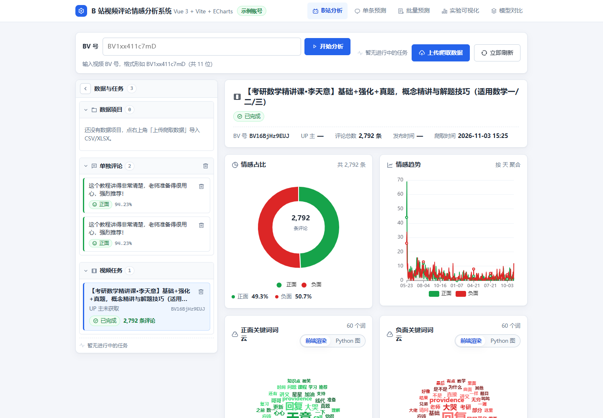
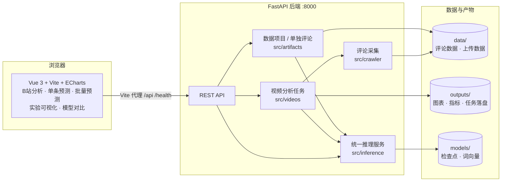
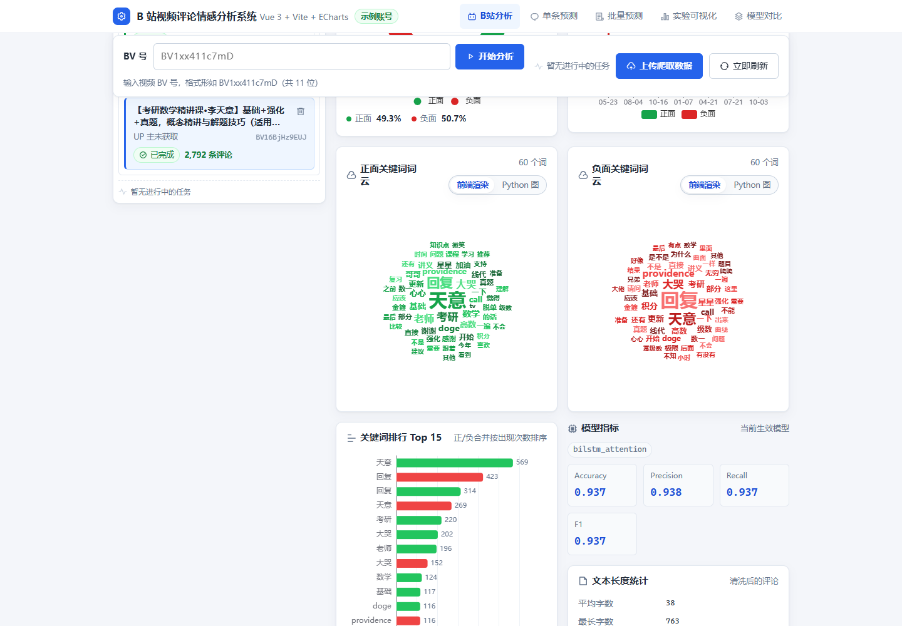
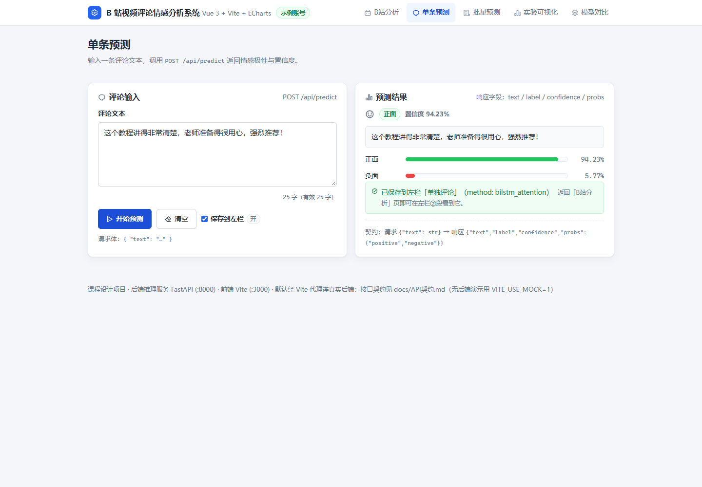
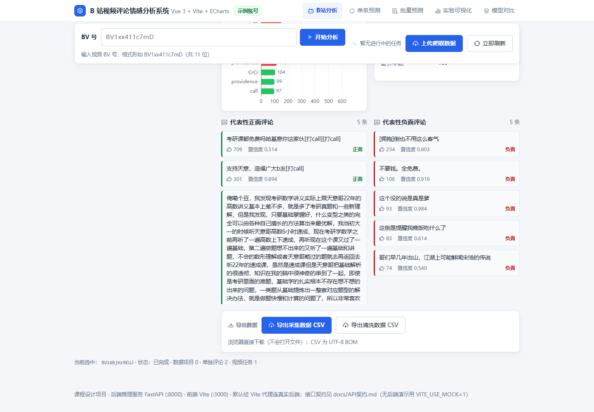
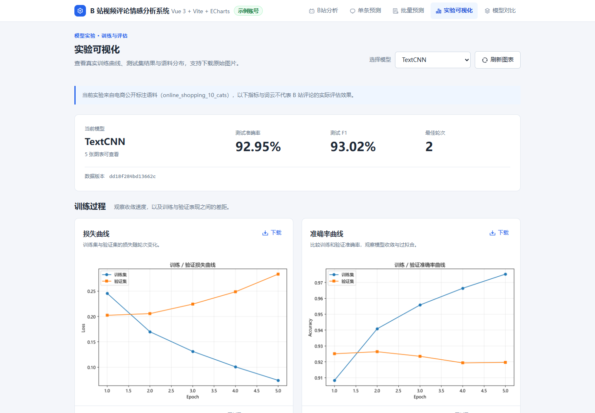

# 网站用户评论情感分析系统

> Website User Comment Sentiment Analysis System

[](https://github.com/tianshiemo7/comment-sentiment-analysis/actions/workflows/ci.yml)


网站用户评论情感分析系统是一个面向网站用户评论的端到端情感分析平台。系统以 B 站视频评论为主流程：输入 BV 号后自动完成任务排队、评论采集、文本清洗、情感推理与统计分析，并在 Web 界面展示情感占比、情感趋势、正负词云、关键词排行、代表性评论与模型指标。

系统同时提供单条预测、批量预测、数据项目上传分析、实验可视化与模型对比等功能。后端基于 FastAPI，前端基于 Vue 3 + Vite + ECharts，情感模型基于电商公开语料训练，开箱即可加载真实权重运行。

**项目状态**：已完成课程设计要求的全部功能与验收，包括 B 站评论分析主流程、四类辅助功能页面、实验可视化、数据导出与工程化测试。

**核心指标**

| 指标 | 数值 |
| --- | --- |
| 训练语料 | online_shopping_10_cats 电商公开标注语料，清洗后 62,622 条（正 31,631 / 负 30,991） |
| 数据划分 | train 43,836 / val 6,262 / test 12,524（7 : 1 : 2，固定随机种子 42） |
| 模型结构 | TextCNN、BiLSTM-Attention（二分类：positive / negative） |
| 测试集准确率 | TextCNN 92.95%（F1 93.02%）；BiLSTM-Attention 93.67%（F1 93.73%） |
| 自动化测试 | 后端 pytest 659 passed / 2 warnings；前端 node:test 19 passed |



## 功能特性

| 模块 | 能力 |
| --- | --- |
| 评论采集 `src/crawler/` | B 站评论接口（WBI 签名、楼中楼、断点续采、风控退避）、通用 HTML 采集、公开数据集下载与校验、标注抽样与合并；限速、robots 校验与来源登记 |
| 数据预处理 `src/preprocessing/` | 文本清洗、jieba 分词、去重与标签冲突审计、7 : 1 : 2 分层划分、词表构建、编码、数据统计 |
| 特征表示 `src/embeddings/` | Word2Vec 词向量训练（仅使用训练集拟合），输出与词表对齐的 embedding 矩阵 |
| 情感模型 `src/models/` | TextCNN（多尺寸卷积核）与 BiLSTM-Attention（双向上下文 + 注意力）两种模型，二选一为主、另一个作对比 |
| 训练与评估 `src/training/` `src/evaluation/` | 统一训练循环（早停、检查点、日志）、Accuracy / Precision / Recall / F1、混淆矩阵、错误分析 |
| 推理服务 `src/inference/` | FastAPI 服务：单条预测、批量预测、模型列表、批量结果导出；四个预测入口复用同一推理器 |
| 视频分析任务 `src/videos/` | 任务状态机与分步流水线（采集 → 清洗 → 推理 → 统计），支持任务级爬虫参数、断点续采、失败重试 |
| 数据项目 `src/artifacts/` | 上传爬虫 CSV 后自动清洗，产出初始 / 筛选后 / 排除记录三张表与逐条情感；单独评论集中管理 |
| 结果可视化 | 情感占比、情感趋势、正负词云（每侧 60 词）、关键词排行、代表性评论、模型指标与文本长度统计 |
| 数据导出 | 视频任务与数据项目支持导出爬虫原始数据、清洗结果 CSV；词云支持切换为 Python 渲染的 PNG 图片 |
| 实验可视化 | 按模型读取真实训练曲线、混淆矩阵与语料词云，支持原图查看、下载与刷新 |
| 前端界面 `frontend/` | Vue 3 + Vite + ECharts：B 站分析主界面与单条预测、批量预测、实验可视化、模型对比四个页面；默认直连真实后端 |
| 工程化 | pytest / node:test 测试、GitHub Actions CI、一键启动脚本、Windows 批处理启动脚本 |

## 系统架构



前端通过 Vite 代理访问后端；视频任务采集到的评论经清洗后进入统一推理服务，推理结果与统计数据落盘到 `outputs/`，图表由后端返回结构化数据、前端用 ECharts 渲染。

## 技术栈

| 层 | 选型 |
| --- | --- |
| 后端 | Python ≥ 3.10、FastAPI + Uvicorn、Pydantic |
| 模型与训练 | PyTorch ≥ 2.2（CPU 可运行）、gensim 4.3.3（Word2Vec）、jieba（分词）、NumPy |
| 前端 | Node.js ≥ 18、Vue 3、Vite、ECharts + echarts-wordcloud |
| 测试与 CI | pytest、httpx / FastAPI TestClient、Node 内置 node:test、GitHub Actions |
| 可选依赖 | Playwright（仅「人工登录窗口」使用；Windows 已装 Edge 时可免装 Chromium）、wordcloud（Python 词云图） |

## 项目结构

```
comment-sentiment-analysis/
├── data/                     数据集与上传数据（评论数据文件不入库，本地保留）
│   ├── raw/                  原始公开语料、爬虫产出、来源登记
│   ├── processed/            清洗分词后的中间数据（大 CSV 不入库，词表/预处理快照入库）
│   ├── splits/               train / val / test（CSV + NPZ；不入库，可由脚本重建）
│   ├── uploads/              界面上传「数据项目」与单独评论的运行期落盘
│   └── sample/               字段格式样例（入库）
├── resources/                分词与清洗资源（stopwords / userdict / emoji_map）
├── src/
│   ├── crawler/              爬虫（B 站 / 通用 HTML / 公开数据集 / 标注）
│   ├── preprocessing/        清洗 + 分词 + 划分 + 词表 + 编码 + 统计
│   ├── embeddings/           Word2Vec 训练与词表对齐的 embedding 矩阵
│   ├── models/               TextCNN / BiLSTM-Attention
│   ├── training/             统一训练循环（早停 / 检查点 / 日志）
│   ├── evaluation/           指标 / 混淆矩阵 / 错误分析
│   ├── visualization/        曲线 / 热力图 / 词云
│   ├── inference/            FastAPI 推理服务（:8000）
│   ├── videos/               B 站视频任务（状态机 / 分步流水线 / 设置 / 人工登录）
│   └── artifacts/            数据项目与单独评论
├── frontend/                 Vue 3 前端（:3000，src/ 业务代码 + mock/ 演示层）
├── models/                   模型检查点与词向量（部署权重已入库）
├── outputs/                  图表 / 日志 / 指标 / 错误样例 / 批量导出 / 任务落盘
├── docs/                     接口契约、运行手册、实验记录与验收文档
├── scripts/                  一键脚本（取数 / 划分 / 训练 / 启动 / 端到端验收 / 图标生成）
├── tests/                    测试
├── requirements.txt          Python 依赖
├── start-backend.cmd         Windows 后端一键启动
└── start-frontend.cmd        Windows 前端一键启动
```

各源码包与数据目录都有独立 `README.md`，说明该部分的职责、输入输出与复现方式。

## 快速开始

### 环境要求

| 依赖 | 版本 | 说明 |
| --- | --- | --- |
| Python | ≥ 3.10（CI 使用 3.11） | 后端、训练与脚本 |
| Node.js | ≥ 18（CI 使用 20） | 前端开发与构建 |
| PyTorch | ≥ 2.2 | 训练与真实模型推理，CPU 即可运行 |

### 安装依赖

```bash
python -m pip install -r requirements.txt

# PyTorch 体积较大，按平台单独安装：
#   CPU ： pip install torch --index-url https://download.pytorch.org/whl/cpu
#   CUDA： pip install torch --index-url https://download.pytorch.org/whl/cu121
```

虚拟环境不是必需的。需要时执行 `python -m venv .venv` 并激活（Windows `.venv\Scripts\activate`，
Linux / macOS `source .venv/bin/activate`）；未创建虚拟环境时，启动脚本会直接使用系统 Python。

### 启动后端（:8000）

```bash
python -m uvicorn src.inference.app:app --host 0.0.0.0 --port 8000 --reload
# 或：bash scripts/serve.sh
# Windows 可直接双击根目录 start-backend.cmd
```

- 接口文档：<http://localhost:8000/docs>
- 默认模型 `bilstm_attention`，可用 `ACTIVE_MODEL=textcnn` 切换；`INFERENCE_DEVICE=auto|cuda` 可启用 GPU。
- 检查点存在时使用真实模型推理；检查点缺失、torch 未安装或权重损坏时自动降级为规则占位预测，
  响应中的 `method` 为 `rule_placeholder`，接口契约保持不变。
- Windows 的 `start-backend.cmd` 优先使用 `.venv\Scripts\python.exe`，未建虚拟环境时回退系统 `python`；
  缺少 `uvicorn` / `fastapi` 时会打印安装指引。

### 启动前端（:3000）

```bash
cd frontend
npm install
npm run dev        # http://localhost:3000
npm run build      # 生产构建，产物在 frontend/dist/
npm test           # 前端单元测试（Node 内置 node:test）
```

前端通过 Vite 代理把 `/api`、`/health` 转发到 `http://localhost:8000`，因此两个服务需同时运行。
默认不加载 mock，所有请求走真实后端；仅需演示界面时可用 `VITE_USE_MOCK=1 npm run dev`
（仅 dev 生效，`npm run preview` 与生产构建始终走代理）。
Windows 可直接双击根目录 `start-frontend.cmd`，缺少 `node_modules` 时会自动执行 `npm install`。

### 配置说明

配置项见 [`.env.example`](.env.example)，复制为 `.env` 后按需修改（`.env` 已被 gitignore）。常用项：

| 变量 | 默认值 | 说明 |
| --- | --- | --- |
| `ACTIVE_MODEL` | `bilstm_attention` | 生效模型：`textcnn` / `bilstm_attention` |
| `INFERENCE_DEVICE` | `cpu` | 推理设备：`cpu` / `cuda` / `auto` |
| `VIDEO_REAL_CRAWL` | `0` | 视频任务是否真实联网采集，`1` 为开启（任务级设置优先） |
| `VIDEO_CRAWL_DELAY` | `2.5` | 采集请求最小间隔（秒），实际下限 2.0 |
| `BILI_API_ROBOTS_POLICY` | `warn` | B 站接口 robots 策略：`warn` / `enforce` / `ignore` |
| `CSA_SETTINGS_PATH` | `outputs/settings.json` | 系统设置与账号 Cookie 落盘路径（不入库） |
| `MAX_LEN` / `MIN_FREQ` | `200` / `3` | 训练与预处理默认超参 |

## 使用指南

1. **B 站评论分析（主流程）**：在「B站分析」页输入 BV 号并确认爬虫参数，任务依次完成采集、清洗、
   情感推理与统计分析；默认可不联网演示（占位评论数据），开启真实采集的配置见「评论采集」一节。
   分步流水线模式下，采集完成停在「待清洗」、清洗完成停在「待分析」，点击按钮或开启自动连续继续，
   完成后即可查看完整图表与代表性评论。
2. **数据项目**：在页面右上角「上传爬取数据」导入爬虫 CSV（`.csv` / `.xlsx`），系统自动清洗并生成
   三张表（初始 / 筛选后 / 排除记录）与逐条情感，可直接在浏览器导出三阶段 CSV。
3. **单条 / 批量预测**：单条预测返回情感极性与置信度，可保存到左栏「单独评论」；批量预测支持
   `.csv` / `.xlsx` 上传并下载结果文件。
4. **实验可视化 / 模型对比**：查看两个模型的真实训练曲线、混淆矩阵、语料词云与测试指标对比。
5. **系统设置**：在「设置」弹窗配置账号模式、采集默认值与自动连续流程；人工登录窗口需要可选依赖
   Playwright，未安装时可手动粘贴 Cookie。

## 数据与模型

### 数据集

| 项目 | 当前部署版本 |
| --- | --- |
| 数据来源 | online_shopping_10_cats 电商评论公开语料 |
| 数据版本 | `dd18f284bd13662c` |
| 有效样本 | 62,622 条（负面 30,991 / 正面 31,631） |
| 划分 | train 43,836 / val 6,262 / test 12,524 |
| 词表 | 20,069（仅用训练集拟合） |
| Word2Vec | 128 维、10 轮，min_count 3、window 5 |

> 训练语料为电商公开标注语料，指标仅代表该测试集，不能直接视为 B 站评论领域的准确率。
> 历史酒店 / 外卖实验记录见 [模型训练与评估（2026-10-30）](docs/模型训练与评估-2026-10-30.md)，
> 当前版本的接入、部署与验收记录见 [电商模型接入与验收（2026-11-02）](docs/电商模型接入与验收-2026-11-02.md)。

### 实验结果

| 模型 | 最佳轮次 | 验证 Acc | 测试 Acc | Precision | Recall | F1 |
| --- | ---: | ---: | ---: | ---: | ---: | ---: |
| TextCNN | 2 | 0.9264 | **0.9295** | 0.9297 | 0.9308 | 0.9302 |
| BiLSTM-Attention | 2 | 0.9318 | **0.9367** | 0.9378 | 0.9368 | 0.9373 |

### 权重与数据策略

- **已入库**：`models/checkpoints/<模型>/best.pt` 及配套预处理包（词表、预处理配置、标签映射与校验
  manifest）、`outputs/figures/` 实验图表、`outputs/stats/` 指标与 `outputs/predictions/` 错误样例，
  clone 后可立即启动服务并查看可视化。
- **未入库**：原始 / 清洗 / 划分后的评论数据、运行期任务落盘与批量导出结果；这些文件本地保留，
  可按下方命令重建。含 Cookie 的 `outputs/settings.json` 绝不入库。
- 当前 shopping-v1 实验的训练输入、词向量与训练日志属于复现材料，不在仓库内（重建方式见实验记录）；
  部署所需的权重与预处理包已随仓库提供。
- 全新 clone 后无需评论数据即可启动服务、加载既有权重进行推理并查看实验图表；视频任务需重新采集评论，
  或自备符合字段约定的 CSV 作为数据项目上传。

### 训练复现

```bash
# ① 固定版本公开语料 → data/processed + data/splits
python -m scripts.prepare_training_data

# ② 词向量（仅用训练集拟合）
python -m src.embeddings --train-file data/splits/train.csv --vocab data/processed/vocab.json \
  --out models/word2vec --embed-dim 128 --window 5 --min-count 3 --epochs 10 --workers 1 --seed 42

# ③ 两个模型（CPU 口径；GPU 环境把 --device 换成 cuda）
python -m src.training.cli --model textcnn --embeddings models/word2vec/embedding_matrix.npy \
  --epochs 20 --batch-size 64 --lr 0.001 --max-len 200 --seed 42 --device cpu --patience 3
python -m src.training.cli --model bilstm_attention --embeddings models/word2vec/embedding_matrix.npy \
  --epochs 20 --batch-size 64 --lr 0.001 --max-len 200 --seed 42 --device cpu --patience 3
```

也可使用一键脚本：`bash scripts/train.sh`（缺少 `data/splits` 时先执行预处理；`WITH_WORD2VEC=1`
使用词向量初始化；`MODELS=textcnn` 只训练一个模型）。训练产物：`models/checkpoints/<模型>/best.pt`、
`outputs/logs/train_*.json`、`outputs/stats/metrics_<模型>.json`、`outputs/figures/*.png`。
上述命令会覆盖 `models/word2vec/` 与 `models/checkpoints/` 下的同名文件，复现实验时建议先备份或在
独立实验目录中执行。

无标签爬虫 CSV → 待预测评论（不生成标签与词表）：

```bash
python -m src.preprocessing --input data/raw/BV1UB4y1W7Xu_comments.csv --mode clean
```

> `--allow-small-dataset` 的演示数据会覆盖当前正式数据，仅用于验证链路。

## 评论采集

```bash
# B 站：默认 2.5 秒/请求，遵守 robots，自动登记来源
python -m src.crawler bilibili --bvid BV1GJ411x7h7 --max-pages 2 --include-replies
# 或统一脚本
bash scripts/get_data.sh BV1GJ411x7h7
# 通用 HTML 采集
python -m src.crawler html --url https://example.com/post --source 示例站点 \
    --selector ".comment-content" --max-items 100
```

- 大规模清单采集、断点续采、登录态与 Web 分步流程见
  [大规模采集运行手册](docs/大规模采集运行手册.md)，实现细节见 [爬虫模块说明](src/crawler/README.md)。
- `/api/videos` 的真实爬取为 opt-in：`VIDEO_REAL_CRAWL=1` 或任务级设置 `real_crawl=true` 才联网，
  默认使用确定性占位评论数据（`detail.placeholder=true` 仅表示评论数据来源，不表示情感来源）。
- 登录 Cookie 只保存在服务端 `outputs/settings.json`（已 gitignore），接口只返回脱敏字段；
  登录态受限时自动单次回退匿名采集，两次都失败才落 `failed` 并给出原因。

## 接口说明

| 分组 | 接口 |
| --- | --- |
| 系统 | `GET /health`、`GET /api/models` |
| 实验图表 | `GET /api/visualizations?model=textcnn`、`GET /api/visualizations/figures/{figure_id}`（`?download=true` 下载 PNG） |
| 单条 / 批量预测 | `POST /api/predict`、`POST /api/predict/batch`、`GET /api/predict/batch/download/{file_id}` |
| 视频任务 | `POST /api/videos`、`GET /api/videos`、`GET /api/videos/{bvid}/detail`、`POST /api/videos/{bvid}/continue`、`POST /api/videos/{bvid}/retry`、`DELETE /api/videos/{bvid}` |
| 设置与账号 | `GET/PUT /api/settings`、`POST /api/crawler/session/check`、`POST /api/account/login/start`、`GET /api/account/login/status`、`POST /api/account/login/cancel` |
| 数据项目 | `POST /api/artifacts/upload`、`GET /api/artifacts`、`GET /api/artifacts/{id}`（`/stages`、`/table`、`/comments`、`/analysis`、`/path`）、`POST /api/artifacts/{id}/open`、`POST /api/artifacts/{id}/analyze`、`DELETE /api/artifacts/{id}` |
| 导出与词云图 | `GET /api/artifacts/{id}/download?stage=initial\|clean\|excluded`、`GET /api/videos/{bvid}/download?stage=crawl\|clean`、`GET /api/artifacts/{id}/wordcloud-image?tone=`、`GET /api/videos/{bvid}/wordcloud-image?tone=`（均支持 `download=true`） |
| 单独评论 | `POST/GET /api/solo-comments`、`DELETE /api/solo-comments/{id}`、`DELETE /api/solo-comments?ids=` |

字段、示例、错误码与安全约束以 [接口契约](docs/API契约.md) 为唯一来源。要点：

- `label` 取 `positive` / `negative`；`probs` / `confidence` 为 0~1 小数；
- `method` 表示情感来源：真实模型名（`textcnn` / `bilstm_attention`）或降级时的 `rule_placeholder`；
- 批量结果落盘 `outputs/predictions/batch_prediction_<时间戳>_<id>.csv`（UTF-8 BOM，Excel 可直接打开）；
- 上传文件首行为表头，文本列自动识别：`text_raw` → `text` → `comment` → `content` → `评论` → 第一列
  （同时含 `text_raw` 与 `text` 时优先使用原文）；
- 批量预测结果的下载接口只允许读取 `outputs/predictions/` 下的 CSV，并已做目录穿越防护；
  数据项目与视频任务的导出接口只读取对应项目 / 任务的产物目录；
- 视频任务导出 `crawl` / `clean` 阶段 CSV 使用爬虫标准列（clean 追加 `raw_text`）；数据项目按
  `initial` / `clean` / `excluded` 导出原样 CSV；词云词频每侧最多 60 项，`wordcloud-image` 返回按需渲染的
  PNG（正面绿色系 / 负面红色系）。

## 数据格式

统一字段：文本 `text`、标签 `label`（仅 `positive` / `negative`，固定 `negative=0`、`positive=1`）。

```csv
text,label
这个商品质量很好，物流也快，非常满意。,positive
```

爬虫产出列（也是上传到界面的输入格式）：

```csv
bvid,aid,video_title,rpid,level,root_rpid,parent_rpid,text,likes,reply_count,ctime_utc,collected_at_utc
BV1UB4y1W7Xu,112233,示例标题,123456,1,,,这个教程讲解清晰,12,3,2026-09-01T12:00:00+00:00,2026-10-16T10:00:00+00:00
```

上传「数据项目」时自动做列名映射（`bvid→video_id`、`rpid→comment_id`、`ctime_utc→posted_at`、
`collected_at_utc→collected_at`）。爬虫落盘前会统一标准化：HTML 实体还原、全角字母数字转半角
（保留中文标点）、删除零宽 / 控制字符、空白归一、纯标点与空文本过滤；emoji 与 B 站表情保留。
每次采集的站点 / URL / 时间 / 条数 / 合规说明自动写入 `data/raw/来源说明.md` 与 `sources.json`。

## 测试与质量

```bash
python -m pytest tests/ -q     # 659 passed / 2 warnings
cd frontend && npm test        # 19 passed（Node 内置 node:test）
python scripts/e2e_smoke.py    # 后端 9 项契约检查（隔离临时目录）
python scripts/e2e_smoke.py --frontend   # 追加前端代理与浏览器渲染验证
```

- 无 torch 环境会自动跳过模型 / 训练相关用例，其余服务与数据处理测试照常运行；
- 端到端脚本只断言契约与结构，不伪造准确率，报告落盘 `outputs/e2e/last_run.json`；
- 实验可视化已通过真实浏览器验证（模型切换、五张 PNG 加载、下载、错误恢复、缺失状态与 390px 布局）；
- 导出 / Python 词云增强的浏览器验收共 14 / 14 项 PASS；
- CI（GitHub Actions）执行 Python 全量测试、前端单元测试与生产构建，见页面顶部 badge。

## 界面截图

以下截图取自本机真实运行环境（真实权重 + 真实采集任务）：

| 正负关键词词云（每侧 60 词，可切换 Python 渲染） | 单条预测（真实模型，`method=bilstm_attention`） |
| --- | --- |
|  |  |

| 代表性评论与数据导出 | 实验可视化（真实训练曲线与指标） |
| --- | --- |
|  |  |

历史界面截图与更早的验收记录见 [docs/images/](docs/images/) 与下方文档索引；前端页面结构、组件与
mock 层说明见 [frontend/README.md](frontend/README.md)。

## 已知限制与合规

- **领域适用性**：当前模型基于电商公开语料训练，B 站评论的极性结果用于趋势与分布参考，不能作为该领域的
  准确率指标；如需 B 站领域指标，可基于 `src/crawler/labeling.py` 构建人工标注集后另行评测。
- **二分类模型**：训练与推理只输出 `positive` / `negative`；接口契约保留 `neutral` 字段供规则回退使用
  （真实模型不产生中性）。前端只在 `neutral > 0` 时渲染中性扇区 / 趋势线 / 比例行。
- **真实爬取为 opt-in**：默认不联网，使用确定性占位评论数据；真实采集需 `VIDEO_REAL_CRAWL=1` 或任务级设置，
  失败会落 `failed` 并给出原因。
- **合规**：遵守 robots 与限速（默认 2.5 秒/请求，硬性下限 2 秒），不绕过风控、不并发抓取；
  仅用于课程学习与研究。
- **凭据安全**：B 站 Cookie 只保存在服务端 `outputs/settings.json`（已 gitignore），接口只回传脱敏字段，
  不随任务提交；人工登录窗口不读取、不记录账号密码。
- **部署形态**：当前为单进程串行部署，适合课程演示与中小规模使用；多 worker / 外部队列不在当前设计范围内。
- **Python 词云图依赖可选库**：`wordcloud`（requirements.txt 已含）缺失时 `wordcloud-image` 返回 503，
  前端自动回退 ECharts 并提示原因；中文字体缺失时图片可能出现方块，可用 `WORDCLOUD_FONT` 指定字体。

## 文档索引

| 文档 | 内容 |
| --- | --- |
| [接口契约](docs/API契约.md) | 前后端唯一接口契约（字段 / 示例 / 错误码 / 设置与分步流水线） |
| [大规模采集运行手册](docs/大规模采集运行手册.md) | 爬虫清单采集 / 登录态 / 断点续采 / Web 分步流程 |
| [data/README.md](data/README.md) · [models/README.md](models/README.md) · [outputs/README.md](outputs/README.md) | 数据、权重与产物的目录职责、入库策略与复现命令 |
| 各模块 README | `src/crawler` · `src/preprocessing` · `src/embeddings` · `src/models` · `src/training` · `src/evaluation` · `src/visualization` · `src/inference` · `src/videos` · `src/artifacts` · `frontend` |
| [开发路线图](docs/开发路线图.md) | 分阶段实现路线与模块拆分 |
| [验收检查清单](docs/验收检查清单.md) | 课程验收逐项自查 |
| [课程设计报告大纲](docs/课程设计报告大纲.md) | 课程报告结构与章节安排 |

**实验与验收记录**

| 文档 | 内容 |
| --- | --- |
| [电商模型接入与验收（2026-11-02）](docs/电商模型接入与验收-2026-11-02.md) | 当前部署版本的数据、指标、权重位置与验收结果 |
| [导出与词云增强（2026-11-04）](docs/导出与词云增强-2026-11-04.md) | 导出文件、词云每侧 60 词、Python 词云图与验证证据 |
| [收尾修复与验证（2026-11-03）](docs/收尾修复与验证-2026-11-03.md) | 前端修复、爬虫匿名回退、仓库数据清理与验证证据 |
| [实时进度显示与验证（2026-11-01）](docs/实时进度显示与验证-2026-11-01.md) | 任务进度轮询与界面验证记录 |
| [实验可视化接入与验证（2026-10-30）](docs/实验可视化接入与验证-2026-10-30.md) | 实验可视化接口、页面与浏览器验收 |
| [模型训练与评估（2026-10-30）](docs/模型训练与评估-2026-10-30.md) | 历史实验的数据版本、训练命令、指标、混淆矩阵与权重哈希 |
| [数据处理验证（2026-10-30）](docs/数据处理验证-2026-10-30.md) | 预处理修复、公开语料复现与无标签评论交接 |
| [爬虫代码审查与改进（2026-10-17）](docs/爬虫代码审查与改进-2026-10-17.md) | 爬虫审查结论、改进点与实测效率 |
| [第二轮全面改进（2026-10-17）](docs/第二轮全面改进-2026-10-17.md) | 第二轮改进与真实数据闭环记录 |
| [数据流通审计与训练链路（2026-10-17）](docs/数据流通审计与训练链路-2026-10-17.md) | 数据流与训练链路审计 |

## 许可证

本项目代码采用 [MIT License](LICENSE)。

界面图标取自 [Remix Icon](https://remixicon.com) v4.9.1（Remix Icon License v1.0），以 path 数据内置在
`frontend/src/assets/icons/`，不新增 npm 依赖、不使用图标字体；图标仅作功能 / 装饰元素，favicon 为项目原创。
完整许可全文、出处与品牌图标使用说明见 [frontend/src/assets/icons/NOTICE.txt](frontend/src/assets/icons/NOTICE.txt)；
图标子集可由 `node scripts/gen_icons.mjs <remixicon 包目录>` 复现。
