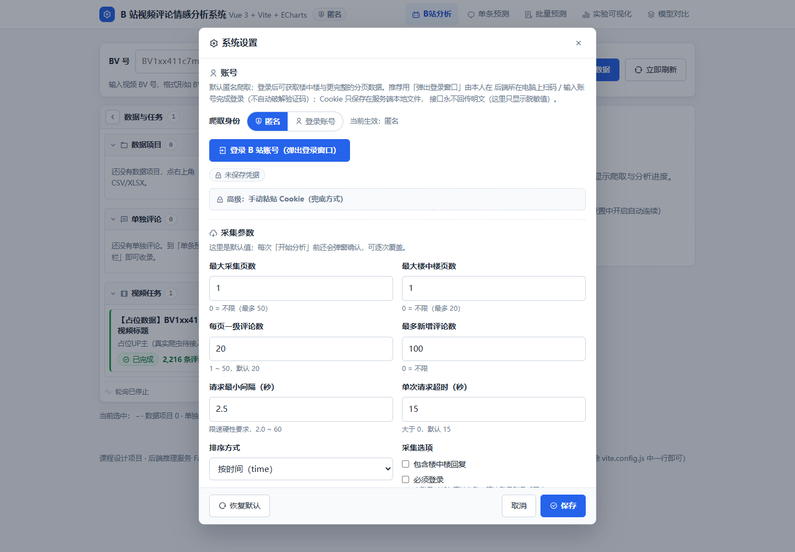
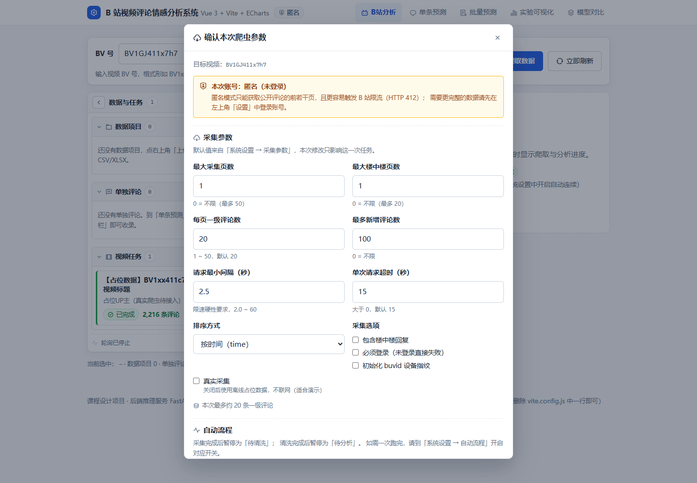
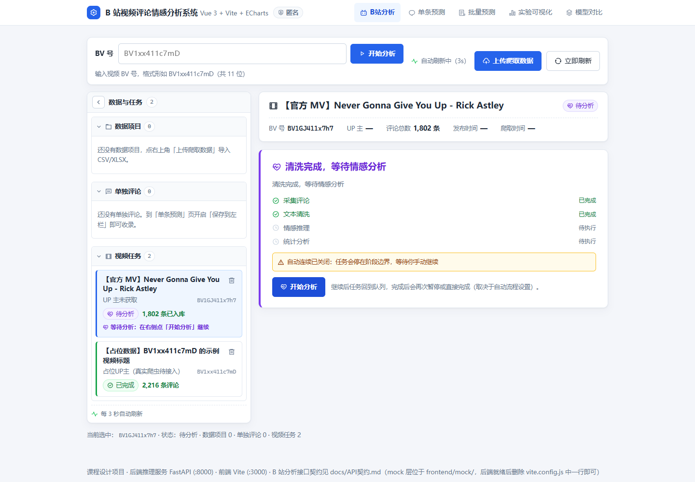
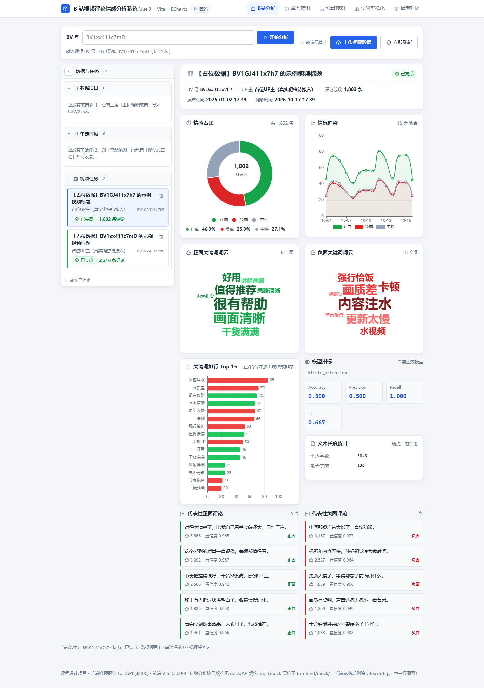

# 网站用户评论情感分析系统

> Website User Comment Sentiment Analysis System

[](https://github.com/tianshiemo7/comment-sentiment-analysis/actions/workflows/ci.yml)


给定网站用户评论文本，自动判断其情感极性（正面 / 负面），并提供可交互的 Web 界面。

**主流程（B 站视频评论分析）**：先点左上角「**设置**」入口配置账号模式（默认匿名；可点
「登录 B 站账号（弹出登录窗口）」由人扫码/登录，也可手动填 B 站 Cookie）与采集默认参数；
在界面顶部输入 **BV 号**点「开始分析」后，先在「**爬虫参数**」弹窗确认本次采集参数，
再提交任务。任务按**分步流水线**执行：采集完成停在「待清洗」、清洗完成停在「待分析」，
由用户点「开始清洗 / 开始分析」继续（也可在设置页开启自动连续）。左侧栏查看所有任务的
实时状态（排队中 / 爬取中 / 处理中 / 待清洗 / 待分析 / 已完成 / 失败 + 进度条），
点击任意一项，右侧展示该视频的详细分析结果：情感占比饼图、情感趋势折线、
正负关键词词云、关键词排行、代表性评论与模型指标。
完整说明见[第十四节](#十四设置入口与分步执行2026-10-17)。

**辅助功能**：单条评论预测、批量文件预测（`.csv` / `.xlsx` 导入导出），用于课程要求的算法演示。

本仓库为**开发中的课程设计项目**，各部分状态如下（避免歧义，逐项说明）：

| 部分 | 状态 |
| --- | --- |
| B 站评论爬虫 `src/crawler/` | ✅ 已实现：WBI 签名 / 风控退避 / 文本标准化 / robots / 来源登记 / 断点续爬 / **大规模批量采集（清单/零请求续采/不限页数/流式合并）** / 公开数据集下载 / 标注抽样与合并 / 效率基准 · 本机实测见 [十二、爬虫模块改进与实测效率](#十二爬虫模块改进与实测效率) |
| 数据处理管线 `src/preprocessing/` | ✅ 已实现（清洗 / 分词 / 划分 / 词表 / 编码 / 统计） |
| 真实数据规模（课程硬指标） | ✅ 公开标注语料审计后 **19,711 条**，`course_requirements_met=true`（train 13,797 / val 1,971 / test 3,943，正面约 47.2%）；`python -m scripts.prepare_training_data` 可复现，数据文件不入库 |
| 前后端页面与接口 `frontend/` + `src/inference/` + `src/videos/` + `src/artifacts/` | ✅ 已实现 |
| 数据项目（右上传爬虫数据 → clean 管线 → 三张表 + 逐条评论情感） | ✅ 已实现（`src/artifacts/`）· ⚠️ 情感为规则占位 |
| 单独评论（单条预测结果存入左栏②段，无图表） | ✅ 已实现 |
| `/api/videos` 链路中的爬取与情感推理 | ✅ 默认占位；任务设置 `real_crawl=true`（或 `VIDEO_REAL_CRAWL=1`）时**真实爬取评论**（情感仍为规则占位），支持分步执行，采集失败落 `failed`；见第十二、十四节 |
| 词向量 / 深度模型 / 训练 / 评估 / 可视化 | ✅ 已实现（Word2Vec、TextCNN、BiLSTM-Attention、训练/早停/日志、指标与四项出图；需装 torch，见第六节） |

2026-10-30 已在本机 Anaconda `deeplearning`（PyTorch 2.11.0+cu128 / RTX 4060 Laptop）完成正式训练与评估：
TextCNN 测试准确率 89.09%、F1 88.10%；BiLSTM-Attention 准确率 89.25%、F1 88.54%。
这是酒店/外卖公开语料测试结果，尚未评估 B 站领域准确率；在线服务仍待接入权重。
复现命令、权重位置及完整实验记录见 [模型训练与评估](docs/模型训练与评估-2026-10-30.md)。

数据处理支持无标签爬虫 CSV 到待预测 CSV 的交接，也支持已标注数据到训练集、词表和模型输入数组的制备。
B 站视频分析链路（输入 BV 号 → 状态跟踪 → 图表词云详情）的前后端与接口契约已落地；
真实爬取可按任务设置或 `VIDEO_REAL_CRAWL=1` 开启；真实模型尚未接入，接口契约不变（见 `docs/API契约.md`）。

---

## 一、项目结构

```
comment-sentiment-analysis/
├── data/                     数据集与上传数据
│   ├── raw/                  原始公开数据集、爬虫原始产出
│   ├── processed/            清洗分词后的中间数据
│   ├── splits/               划分后的 train / val / test
│   ├── uploads/              界面上传的「数据项目」落盘（含 solo_comments.json）
│   └── sample/               字段格式样例（照此格式准备数据）
├── resources/                分词与清洗资源（stopwords / userdict / emoji_map）
├── src/                      Python 主干代码
│   ├── crawler/              ① 爬虫模块（B 站评论采集）
│   ├── preprocessing/        ② 数据清洗 + jieba 分词 + 切分 + 词表构建
│   ├── embeddings/           ③ 词向量（Word2Vec / GloVe）
│   ├── models/               ④ 模型（CNN / BiLSTM-Attention，BERT 微调预留）
│   ├── training/             ⑤ 训练与验证循环
│   ├── evaluation/           ⑥ 指标评估（Accuracy / P / R / F1 / 混淆矩阵）
│   ├── visualization/        ⑦ 结果可视化（曲线 / 热力图 / 词云 / Attention）
│   ├── videos/               B 站视频分析任务（状态机 + 详情 + 系统设置，供前端①③段调用）
│   │   ├── settings.py       设置读写/校验（账号 Cookie、采集默认值、自动流程），落盘 outputs/settings.json
│   │   └── browser_login.py  人工登录窗口（Playwright/Edge，可选依赖；后端本机弹窗，人完成登录）
│   ├── artifacts/            数据项目与单独评论（上传 → clean 管线 → 三张表 + 占位情感）
│   └── inference/            ⑧ FastAPI 推理服务（:8000，供前端调用）
├── notebooks/                实验记录与探索性分析（EDA）
├── frontend/                 Node.js 前端展示（Vue 3 + Vite，:3000）
│   ├── src/views/            B站分析(首页) / 单条预测 / 批量预测 / 可视化 / 模型对比
│   ├── src/components/       左栏三段、BV 输入框、设置弹窗、爬虫参数弹窗、项目/评论详情与 ECharts 图表组件
│   ├── src/composables/      轮询与详情状态（usePolling / useArtifacts / useSettings 等）
│   ├── src/api/              接口封装（artifacts.js 主流程、videos.js、settings.js、account.js、client.js）
│   ├── src/components/Icon.vue  统一图标组件（内联 SVG，零依赖）
│   ├── src/assets/icons/     内置的 Remix Icon 线稿图标子集（数量与出处见 NOTICE.txt）
│   └── mock/                 接口模拟层（Vite 插件，含设置/人工登录/分步流水线；一行卸载）
├── models/                   训练好的模型权重存放目录
│   ├── checkpoints/          训练检查点（.pt / .pth）
│   ├── word2vec/             词向量文件
│   └── bert/                 BERT 微调权重
├── outputs/                  产物输出
│   ├── figures/              图表（曲线、混淆矩阵、词云、Attention）
│   ├── logs/                 训练日志
│   ├── predictions/          批量预测导出结果
│   ├── stats/                数据统计（词表规模、平均长度、标签分布）
│   ├── videos/               B 站任务落盘（index.json + 每个视频一份详情 + 分步中间产物）
│   └── settings.json         系统设置与账号凭据（本地生成、已被 .gitignore 忽略；切勿提交）
├── docs/                     文档与课程报告
├── scripts/                  一键脚本（取数 / 划分 / 训练 / 启动服务 / 生成图标子集 / 前端图标验收）
├── tests/                    测试
└── requirements.txt          Python 依赖（含可选 playwright：仅人工登录窗口需要）
```

## 二、需求对照表

| 课程要求 | 对应位置 | 状态 |
| --- | --- | --- |
| 数据集：训练 ≥ 8000、测试 ≥ 2000、正负均衡 | `data/` `data/sample/` | ✅ 公开标注有效 **19,711 条**（train 13,797 / test 3,943，正面约 47.2%）；无 B 站人工标注，复现命令见第四节 |
| 数据来源：公开数据集或爬虫（遵守 robots，注明来源与采集时间） | `src/crawler/` | ✅ 爬虫已实现 WBI 签名 / 限速 / robots 校验 / 来源登记（`data/raw/来源说明.md`），实测见第十二节 |
| 划分 7 : 1 : 2 | `src/preprocessing/split.py` | 已实现 分层或按视频分组 |
| 中文 jieba 分词、英文分词小写化；去停用词/URL/HTML/特殊符号 | `src/preprocessing/` | 已实现 保护否定词与表情信息 |
| 统一 max_len（如 200）截断补齐 | `src/preprocessing/processor.py` | 已实现 同时输出有效长度及掩码 |
| 词表构建 min_freq ≥ 3，统计词表规模/平均长度/标签分布 | `src/preprocessing/` → `outputs/stats/` | 已实现 词表仅使用训练集 |
| 词向量 Word2Vec / GloVe | `src/embeddings/` | ✅ Word2Vec 已实现（GloVe 可加载外部预训练向量，未内置下载） |
| 两种深度模型搭建、训练与对比 | `src/models/` `src/training/` | ✅ 已实现（TextCNN / BiLSTM-Attention + 统一训练循环 + 模型对比表） |
| 指标 Accuracy / Precision / Recall / F1 / 混淆矩阵 | `src/evaluation/` | ✅ 已实现（含宏平均与错误分析） |
| 损失 / 准确率曲线、混淆矩阵热力图、正负词云、Attention 可视化 | `src/visualization/` → `outputs/figures/` | ✅ 已实现（训练 CLI 自动出图） |
| 可运行入口：CLI 或 Web 界面 | `src/inference/` + `frontend/` | 已实现 |
| **B 站视频评论分析主流程**（输入 BV 号 → 状态跟踪 → 图表词云详情） | `frontend/` + `src/videos/` + `docs/API契约.md` | 已实现；真实爬取按任务设置 opt-in（默认占位演示），情感仍规则占位 |
| **设置入口 + 爬虫参数弹窗 + 分步流水线**（账号 Cookie / 参数确认 / 待清洗 / 待分析） | `frontend/` + `src/videos/settings.py` + `docs/API契约.md` | ✅ 已实现（见[第十四节](#十四设置入口与分步执行2026-10-17)） |
| **爬虫数据上传 → 处理结果项目**（初始数据 / 筛选后结果 / 排除记录 + 逐条评论情感） | `src/artifacts/` + 前端左栏①段 | 已实现（情感为规则占位） |
| **单独评论集中管理**（单条预测结果存入左栏②段） | `src/artifacts/` + 前端②段 | 已实现 |
| 输入一条评论 → 情感极性与置信度 | `POST /api/predict` | 已实现 |
| 批量预测 .csv/.xlsx 并导出 | `POST /api/predict/batch` | 已实现 |
| requirements.txt 与 README 说明环境/数据路径/命令 | `requirements.txt` `README.md` | ✅ |
| 课程设计报告（≥ 5000 字，8 章结构） | `docs/课程设计报告大纲.md` | 大纲就绪 |

## 三、环境要求

| 组件 | 版本 | 用途 |
| --- | --- | --- |
| Python | ≥ 3.10（开发环境 3.13 已通过） | 爬虫、预处理、训练、推理服务 |
| Node.js | ≥ 18（开发环境 24 已通过） | 前端开发与构建 |
| npm | 随 Node 附带 | 前端依赖管理 |
| PyTorch | ≥ 2.2（CPU 即可） | 训练 TextCNN / BiLSTM-Attention；未安装时跳过训练与模型测试 |
| Playwright（**可选**） | ≥ 1.40 | 仅「人工登录窗口」需要（后端本机弹浏览器、由人完成登录）；未安装时可用手动 Cookie，其它功能不受影响。Windows 已装 Edge 可跳过 Chromium 安装 |

## 四、快速开始

### 1. 后端推理服务（端口 8000）

```bash
# 在仓库根目录
python -m venv .venv
# Windows: .venv\Scripts\activate      Linux/macOS: source .venv/bin/activate
pip install -r requirements.txt

# 启动服务
python -m uvicorn src.inference.app:app --host 0.0.0.0 --port 8000 --reload
# 或使用脚本
bash scripts/serve.sh
```

接口文档（FastAPI 自动生成）：http://localhost:8000/docs

### 2. 前端展示（端口 3000）

```bash
cd frontend
npm install
npm run dev        # 开发模式，访问 http://localhost:3000
npm run build      # 生产构建，产物在 frontend/dist/
```

前端通过 Vite 代理把 `/api`、`/health` 转发到 `http://localhost:8000`，
因此**两个服务需同时运行**。

### 3. 首次使用：在「设置」里配置账号与采集默认值

打开 <http://localhost:3000> → 左上角齿轮按钮「设置」：

1. **账号**：默认**匿名**爬取；如需登录账号，点「登录 B 站账号（弹出登录窗口）」，在后端所在
   机器的桌面上用扫码 / 账号密码 + 验证码完成登录，后端会自动捕获 Cookie 并显示「已登录：昵称」；
   也可展开「高级：手动粘贴 Cookie」把浏览器里的 `SESSDATA`（或完整 Cookie 串）粘贴进来，
   点「检查登录状态」后「保存」；
2. **采集参数**：按需调整页数 / 每页条数 / 楼中楼 / 排序 / 最大条数 / 间隔 / 超时 /
   要求登录 / 初始化 buvid，并「保存」为默认值（每次提交任务时还会弹窗确认并可覆盖）；
3. **自动流程**：默认关闭「自动清洗」「自动分析」，即采集完停在「待清洗」、清洗完停在「待分析」。

> 人工登录窗口依赖可选的 Playwright：`pip install playwright` +
> `python -m playwright install chromium`（Windows 已装 Edge 可直接用系统 Edge）。
> 未安装不影响其它功能，点按钮会返回 503 与安装指引，此时改用手动 Cookie 即可。

B 站 Cookie 只保存在**服务端** `outputs/settings.json`（可用环境变量 `CSA_SETTINGS_PATH` 覆盖；
该文件已被 `.gitignore` 忽略，**切勿提交**）。接口只返回 `has_cookie` / `masked_cookie`
脱敏字段，任务提交也不会携带 Cookie。登录方式与合规提醒见
[第十四节](#十四设置入口与分步执行2026-10-17)。

### 4. 数据处理与后续训练

```bash
# 接收上游无标签爬虫CSV，清洗后交给下一步情感预测
python -m src.preprocessing --input data/raw/BV1UB4y1W7Xu_comments.csv --mode clean

# 人工编写的演示数据，只用于检验管线，不能作为真实实验语料
python -m src.preprocessing --input data/sample/bilibili_demo.csv --allow-small-dataset

# 正式处理：默认检查训练不少于8000、测试不少于2000及分布条件
python -m src.preprocessing --input data/raw/comments_labeled.csv

# 使用新输出目录或显式 --overwrite 可以重跑；Shell入口同样可用
bash scripts/split_data.sh --input data/raw/comments_labeled.csv

# 训练 + 测试评估 + 出图（需要 PyTorch；data/splits 不存在时会先跑上面的预处理）
bash scripts/train.sh

# 只训练一个模型 / 指定超参 / 顺带训练词向量并用预训练 embedding 初始化
MODELS=textcnn TRAIN_ARGS="--epochs 20 --batch-size 64" bash scripts/train.sh
WITH_WORD2VEC=1 bash scripts/train.sh

# 小样本冒烟（样例数据必须加 --allow-small-dataset；训练结果只用于验证链路）
python -m src.preprocessing --input data/sample/bilibili_demo.csv --allow-small-dataset
bash scripts/train.sh
```

无标签模式输出 `data/processed/comments_cleaned.csv`，保留原文、清洗文本、分词及采集元数据，不生成情感标签、训练词表或训练划分。
默认 auto 模式会识别无标签输入；混合标签文件需明确选择 clean 或 train。
下一步预测需接入训练好的模型，并使用模型配套资源处理 text_raw。

有标签训练模式输出包括 `data/splits/{train,val,test}.csv` 与同名 `.npz`、训练词表、预处理资源快照、标签映射、
输入和产物哈希、排除记录及统计。模型输入数组为 `input_ids`、`attention_mask`、`lengths` 和 `labels`，
标签统一为 `negative=0、positive=1`。后续预测应加载这套资源，不能重新建立词表。
详细字段、参数、验收策略与下游调用示例见 [数据处理说明](src/preprocessing/README.md)。

### 5. 数据采集（爬虫）

```bash
# B 站评论：采集 2 页一级评论 + 楼中楼；默认 2.5 秒/请求、遵守 robots、自动登记来源
python -m src.crawler bilibili --bvid BV1GJ411x7h7 --max-pages 2 --include-replies

# 机器可读报告（请求数 / 重试 / 延迟分位 / 风控恢复次数）
python -m src.crawler bilibili --bvid BV1GJ411x7h7 --max-pages 1 --json

# 或使用统一脚本（参数见脚本头部注释）
bash scripts/get_data.sh BV1GJ411x7h7

# 通用 HTML 页面（robots + 限速 + CSS 选择器）
python -m src.crawler html --url https://example.com/post --source 示例站点 \
    --selector ".comment-content" --max-items 100

# 采集后：来源登记在 data/raw/来源说明.md 与 sources.json；
# 再交给预处理清洗
python -m src.preprocessing --input data/raw/BV1GJ411x7h7_comments.csv --mode clean
```

爬虫单元测试与效率基准（离线 mock，不访问真实站点）：

```bash
python -m pytest tests/test_crawler.py -q
python scripts/bench_crawler.py offline --pages 5 --per-page 20 --include-replies
```

### 6. 公开数据集、标注与 `/api/videos` 真实爬取

正式训练输入使用固定上游提交及 SHA256，保留冲突记录供统一预处理审计：

```bash
python -m scripts.prepare_training_data
```

当前制备结果为 train 13,797 / val 1,971 / test 3,943；未提前下采样，
各集合正面比例约 47.2%，满足项目的 45%—55% 检查。
原始来源、采集时间及制备统计保存于 `data/raw/training_corpus/` 和
`outputs/stats/training_data_preparation.json`。以下为通用下载、格式转换及可选下采样工具用法，
旧版 2026-10-17 实测数值保留在当日审查文档中，不能与当前数据版本混用。

```bash
# 查看/下载公开带标签中文情感语料（下载后自动登记来源；校验失败不会留下半成品）
bash scripts/get_data.sh --list-datasets
bash scripts/get_data.sh --dataset chnsenticorp
python -m src.crawler.datasets --import-csv data/raw/datasets/ChnSentiCorp_htl_all.csv \
    --output data/raw/chnsenticorp_unified.csv
bash scripts/get_data.sh --dataset waimai_10k
python -m src.crawler.datasets --import-csv data/raw/datasets/waimai_10k.csv \
    --output data/raw/waimai_10k_unified.csv

# 可选：多份语料合并 + 类别均衡（按较小类别下采样）
python -m src.crawler.datasets --merge-balance \
    data/raw/waimai_10k_unified.csv data/raw/chnsenticorp_unified.csv \
    --output data/raw/comments_labeled_balanced.csv --seed 42

# 对自行准备的已标注文件执行预处理，实际规模与达标判决以生成报告为准
python -m src.preprocessing --input data/raw/comments_labeled_balanced.csv

# 无标签评论 → 标注候选（按 video_id 分层、固定 seed、输出 manifest）
python -m src.crawler.labeling export --input data/raw/BV1GJ411x7h7_comments.csv \
    --output data/labeling/sample.csv --sample-size 500 --seed 42
# 人工标注后合并并校验（标签取值 / 重复 id / 冲突 / 缺失）
python -m src.crawler.labeling merge --sample data/labeling/sample.csv \
    --labels data/labeling/labels.csv --output data/raw/comments_labeled.csv

# /api/videos 真实爬取（opt-in；默认关闭，开启后「采集评论」阶段会真的联网）
VIDEO_REAL_CRAWL=1 VIDEO_CRAWL_MAX_PAGES=1 VIDEO_CRAWL_DELAY=2.5 \
    python -m uvicorn src.inference.app:app --port 8000
```

> 真实采集失败时任务会落 `failed` 并带可读原因，不会卡在 `crawling`；
> 真实评论进入 detail 后 `placeholder=false`，但情感极性仍是规则占位（`method=rule_placeholder`）。
> 完整参数见 `src/videos/README.md` 与 `src/crawler/README.md`。

## 五、当前实现状态（开发中）

服务与界面已可运行，但**预测结果为占位实现，不是训练出来的模型**：

| 部分 | 状态 |
| --- | --- |
| FastAPI 推理服务（单条/批量预测与模型列表） | ✅ 可运行，契约已锁定 |
| 批量上传解析与结果导出下载 | ✅ 可用（csv / txt / tsv / xlsx，导出 UTF-8 BOM CSV） |
| 前端页面（B站分析主界面 + 单条预测 / 批量预测 / 实验可视化 / 模型对比） | ✅ 可运行（`npm run dev`），真实调用后端接口 |
| B 站分析主流程接口 `/api/videos*` | ✅ 已实现（`src/videos/`），任务状态机 + 详情接口；默认占位，`VIDEO_REAL_CRAWL=1` 时真实爬取评论（情感仍规则占位）；2026-10-17 起支持按任务 `settings` 分步执行（`crawled` / `cleaned` 等待态 + `continue`） |
| 设置入口与分步流水线 | ✅ 已实现：左上角设置弹窗（账号 / 采集参数 / 自动流程）、人工登录窗口、爬虫参数弹窗、`crawled`/`cleaned` 等待态与继续按钮；详见[第十四节](#十四设置入口与分步执行2026-10-17) |
| 情感预测逻辑 | ⚠️ **规则占位**：`src/inference/service.py:predict_rule_based`，内置 140 词情感词表（含程度副词与否定词翻转）。它能对明显正面/负面的评论给出方向正确的结果，用于打通链路，**不是深度学习模型** |
| 数据读写 / 清洗分词 / 去重冲突审计 / 划分 / 词表 / 编码 / 统计 | ✅ 已实现，含训练与推理共用资源及防泄漏校验 |
| B 站爬虫 `src/crawler/` | ✅ 可采集：WBI 签名 / 限速抖动 / 风控退避 / 文本标准化 / robots 校验 / 来源登记 / 断点续爬；`python -m src.crawler bilibili --help`，实测见第十二节 |
| 词向量 / 两个深度模型 / 训练 / 评估 / 可视化 | ✅ 已实现：Word2Vec（`src/embeddings/`）+ TextCNN / BiLSTM-Attention（`src/models/`）+ 早停/检查点/日志（`src/training/`）+ 指标/混淆矩阵/错误分析（`src/evaluation/`）+ 曲线/热力图/词云（`src/visualization/`）。**需要 PyTorch**；用真实数据训练后 `metrics_<模型>.json` 会让 `/api/models` 显示真实指标 |

训练链路已实现（`bash scripts/train.sh`）：预处理产物 → DataLoader → TextCNN / BiLSTM-Attention
→ 早停 + best 检查点 → 测试集指标 / 对比表 / 错误样例 → 曲线 / 混淆矩阵 / 词云。
产物位置：`models/checkpoints/<模型>/best.pt`、`outputs/logs/train_*.json`、
`outputs/stats/metrics_<模型>.json`、`outputs/figures/*.png`。

注意：**训练需要安装 PyTorch**（`requirements.txt` 中按注释单独安装）；不装 torch 时
`pytest` 会自动跳过模型/训练相关用例，其余服务与数据处理测试照常运行。
训练出的检查点目前**还未接入推理服务**：替换真实模型的入口仍是实现 `src/inference/service.py`
的 `load_model` 与 `predict_text`，加载成功后接口契约不变、`method` 自动变成模型名。
**近期还要做什么、做到什么程度算完成**，见下方「短期实现目标」一节。

## 六、前后端接口契约

契约已锁定，前后端按此实现，任何一侧不得单方面改名。

| 方法 | 路径 | 请求 | 响应 |
| --- | --- | --- | --- |
| GET | `/health` | — | `{"status":"ok","service":str,"version":str}` |
| POST | `/api/predict` | `{"text": str}` | `{"text":str,"label":"positive"\|"negative","confidence":float,"probs":{"positive":float,"negative":float},"method":str}` |
| POST | `/api/predict/batch` | multipart 文件（字段名 `file`；支持 `.csv` / `.txt` / `.tsv` / `.xlsx`） | `{"total":int,"results":[{"index":int,"text":str,"label":str,"confidence":float}],"export_url":str}` |
| GET | `/api/predict/batch/download/{file_id}` | — | `text/csv` 附件（批量结果导出，UTF-8 BOM，Excel 可直接打开） |
| GET | `/api/models` | — | `{"models":[{"name":str,"type":str,"metrics":{"accuracy":float,"precision":float,"recall":float,"f1":float},"ready":bool}]}` |
| GET | `/api/videos` | — | 视频任务列表（左侧栏「视频任务」段） |
| POST | `/api/videos` | `{"bvid": str, "settings": {...}?}` | 创建分析任务；**省略 `settings` = 旧行为一次跑完**，带 `settings` 则按分步流水线执行 |
| GET | `/api/videos/{bvid}/detail` | — | 视频分析详情（图表 / 词云 / 评论 + 顶层 `pipeline` 字段） |
| POST | `/api/videos/{bvid}/retry`、`DELETE /api/videos/{bvid}` | — | 重试 / 删除任务 |
| POST | `/api/videos/{bvid}/continue` | — | 继续等待态任务（`crawled`→清洗、`cleaned`→分析）；其他状态 409、未知 404 |
| GET | `/api/settings` | — | 读取系统设置（B 站 Cookie **脱敏**，只返回 `has_cookie` / `masked_cookie`） |
| PUT | `/api/settings` | 部分更新 `{"account":{...},"crawl":{...},"pipeline":{...}}` | 保存系统设置；账号模式缺 Cookie / 数值越界 / 枚举非法 → 400 |
| POST | `/api/crawler/session/check` | 可选 `{"cookie": str}`（临时检查用） | 检查 B 站登录态；无凭据返回匿名态；网络/接口异常 → 502 |
| POST | `/api/account/login/start` | — | 在后端所在机器桌面弹出真实浏览器登录窗口，由人扫码/登录；依赖缺失 → 503（幂等：等待中重复调用返回当前状态） |
| GET | `/api/account/login/status` | — | 轮询登录窗口状态：`state` / `message` / `uname` / `mid` / `has_cookie` / `started_at` / `updated_at` |
| POST | `/api/account/login/cancel` | — | 取消本次登录并关闭窗口 |
| GET | `/api/artifacts` | — | 左栏三段列表：`数据项目` / `单独评论` / `视频任务` |
| POST | `/api/artifacts/upload` | multipart `files`（可多个）+ 可选 `name` | 上传爬虫数据 → 落盘为**数据项目**，自动处理 |
| GET | `/api/artifacts/{id}`、`/stages`、`/table?stage=&offset=&limit=` | — | 项目状态 / 表清单 / **分页读表** |
| GET | `/api/artifacts/{id}/comments?offset=&limit=&label=` | — | **逐条评论情感（可展开）** |
| GET | `/api/artifacts/{id}/analysis` | — | 聚合情感分析（`method` 标明占位或模型名） |
| POST | `/api/artifacts/{id}/open` | `{"stage": "clean"}` | **在服务器本机**用系统程序打开该 CSV |
| GET | `/api/artifacts/{id}/path?stage=clean` | — | 只读取该 CSV 的路径（**无副作用，不打开程序**，供「复制文件地址」用） |
| POST | `/api/artifacts/{id}/analyze`、`DELETE /api/artifacts/{id}` | — | 重新处理 / 删除项目 |
| POST | `/api/solo-comments` | `{"text","label","confidence","probs","method"}` | 保存单条评论到左栏「单独评论」段 |
| GET | `/api/solo-comments?offset=&limit=`、`DELETE /api/solo-comments/{id}` | — | 列表 / 删除（`?ids=` 批量删除，幂等） |

说明：

- `label` 取值 `positive` / `negative`，`probs` / `confidence` 均为 **0~1** 的小数；
- 批量接口把结果写入 `outputs/predictions/batch_prediction_<时间戳>_<id>.csv`，`export_url` 即上表第 4 行的下载地址；
- 上传文件首行为表头，文本列自动识别顺序：`text` → `comment` → `content` → `评论` → 第一列；
- 其他后缀（如 `.xls`、无后缀）返回 400；前端文件选择框当前只开放 `.csv` / `.xlsx`；
- 非法文件名返回 400、不存在的文件返回 404（下载路径已做目录穿越防护）。
- **数据项目**：上传爬虫 CSV 后落盘到 `data/uploads/<项目id>/`，自动按 `clean` 模式跑一遍
  `src/preprocessing` 管线，产出 `initial.csv`（初始数据）、`clean.csv`（筛选后结果）、
  `excluded.csv`（排除记录）三张表与逐条情感；标题未指定时显示「未自定义数据」。
- **单独评论**：粒度与视频任务相当但**不渲染图表**（只有原文 / 极性 / 置信度 / 概率条），
  由「单条预测」页的「保存到左栏」开关写入。
- **情感结果当前是占位**：`method` 字段为 `rule_placeholder`（140 词规则预测器），
  界面据此显示「规则占位」标识，接入真实模型后自动变为模型名。
- **设置与分步流水线（2026-10-17 新增）**：`settings` 只随任务提交「账号模式 + 采集参数 +
  自动流程」，**Cookie 永远取服务端保存值，不随任务传输**；任务处于 `crawled`（待清洗）/
  `cleaned`（待分析）时不再自动轮询，需调 `continue` 或开启自动连续。登录账号推荐用
  「登录 B 站账号（弹出登录窗口）」（后端本机弹真实浏览器，由人完成登录，可选 Playwright），
  手动 Cookie 为高级兜底。常见错误码：设置非法 `400`、未知任务 `404`、非等待态继续 `409`、
  登录态检查网络异常 `502`、人工登录依赖缺失 `503`。
  **旧请求体 `{"bvid": str}` 不带 `settings` 仍然有效**，行为与旧版一致（一次跑完四阶段）。
- 完整字段定义与安全约束见 [`docs/API契约.md`](docs/API契约.md) 四点五节与二点五节。

## 七、数据格式约定

单条评论文本字段统一命名为 `text`，情感标签字段为 `label`（取值 `positive` / `negative`）。

`data/sample/train_sample.csv`（最小格式，用于训练管线）：

```csv
text,label
这个商品质量很好，物流也快，非常满意。,positive
```

`data/sample/test_sample.csv`（无标签，用于批量预测）：

```csv
id,text
1,东西一般般，没有想象中那么好。
```

`data/sample/bilibili_demo.csv`（**人工编写的演示数据**，用于打通界面①段，不可用于正式实验）：

```csv
comment_id,video_id,text,label,source
demo001,demo_video01,这个教程讲解清晰看完就学会了,positive,人工编写演示样本
```

**爬虫产出格式**（`src/crawler/bilibili.py` 实际写出的列，也是上传到界面的输入格式）：

```csv
bvid,aid,video_title,rpid,level,root_rpid,parent_rpid,text,likes,reply_count,ctime_utc,collected_at_utc
BV1UB4y1W7Xu,112233,示例标题,123456,1,,,这个教程讲解清晰,12,3,2026-09-01T12:00:00+00:00,2026-10-16T10:00:00+00:00
```

> 上传到「数据项目」时，预处理会自动做列名映射：`bvid → video_id`、`rpid → comment_id`、
> `ctime_utc → posted_at`、`collected_at_utc → collected_at`，因此按视频分组划分能直接生效。
> 详见 `data/uploads/README.md` 与 `src/artifacts/README.md`。
>
> 爬虫落盘前会做**统一标准化**：HTML 实体还原、全角字母数字转半角（保留中文标点）、
> 删除零宽/控制字符、空白归一、纯标点与空文本过滤；emoji 与 `[笑哭]` 等 B 站表情保留。
> 每次采集的「站点 / URL / 采集时间 / 条数 / 合规说明」自动写入
> [`data/raw/来源说明.md`](data/raw/来源说明.md)，同时保留机器可读的 `data/raw/sources.json`。

## 八、目录职责

每个源码包内附 `README.md`，说明该模块的职责、输入输出、待实现内容与对应需求条目。
详见 [`docs/开发路线图.md`](docs/开发路线图.md)。

## 九、开发团队与分工

见 [`docs/课程设计报告大纲.md`](docs/课程设计报告大纲.md) 第 8 章，待填写。

## 十、B 站主流程界面（前端设计）

界面分四块：顶部「设置入口 + 账号徽标 + BV 输入框」、左侧可收起任务栏、右侧详情区，
以及「系统设置」「爬虫参数」两个弹窗。

```
┌────────────────────────────────────────────────────────────────────┐
│ [⚙ 设置] 账号：匿名   [BV号输入框______________]  [开始分析] ← 顶部   │
├──────────────────────┬─────────────────────────────────────────────┤
│ 左侧栏（可收起）       │ 右侧详情区                                   │
│ ┌──────────────────┐ │ ┌─────────────────────────────────────────┐ │
│ │BV1xx…  ●爬取中    │ │ │ 视频信息：标题/UP主/评论数/时间          │ │
│ │▓▓▓▓░░░░ 43%      │ │ ├─────────────────────────────────────────┤ │
│ ├──────────────────┤ │ │ 情感占比饼图 · 情感趋势折线              │ │
│ │BV1yy…  ●待清洗    │ │ │ 正/负词云 · 关键词排行                   │ │
│ ├──────────────────┤ │ │ 代表性评论 · 模型指标                    │ │
│ │BV1zz…  ●待分析    │ │ └─────────────────────────────────────────┘ │
│ ├──────────────────┤ │ 等待态 → 「开始清洗 / 开始分析」按钮 + 提示  │
│ │BV1ww…  ●已完成    │ │ 未完成 → 「处理中」+ 进度 + 子步骤           │
│ └──────────────────┘ │                                             │
└──────────────────────┴─────────────────────────────────────────────┘
```

要点：

- **左上角设置入口**（替代原「情」品牌标记）：齿轮按钮 `aria-label="设置"`，旁边显示当前
  账号模式徽标（匿名 / 已登录昵称）。点击打开「系统设置」弹窗，分「账号 / 采集参数 /
  自动流程」三组：账号区主按钮为「登录 B 站账号（弹出登录窗口）」（也可展开
  「高级：手动粘贴 Cookie」兜底），另有「检查登录状态」「保存」「取消」「恢复默认」；
  保存调用 `PUT /api/settings`，打开时加载 `GET /api/settings`，后端未启动时用内置默认值并提示。
- **爬虫参数弹窗**：点「开始分析」不再直接提交，先弹出「爬虫参数」弹窗，预填设置页的
  采集参数，展示当前账号模式与匿名提示；用户可逐次覆盖本次参数，确认后才带 `settings`
  调 `POST /api/videos`，取消不提交。
- **左侧栏分三段**（各自可收起、各自记忆状态）：
  1. **数据项目** —— 右上角「上传爬取数据」上传的爬虫 CSV，落盘后自动跑 `clean` 管线，
     条目显示 `初始行数 → 筛选后行数`；未指定名称时显示「未自定义数据」；
  2. **单独评论** —— 集中存放「单条预测」页保存的单条评论（粒度和视频相当，但**不渲染图表**）；
  3. **视频任务** —— 输入 BV 号创建的分析任务（状态徽章 / 进度条 / 评论数）。
- **数据项目详情**：三张表可切换查看（初始数据 / 筛选后结果 / 排除记录），
  支持分页；并可**展开逐条评论的情感**（原文 + 极性 + 置信度）；
  操作按钮统一放在**最底部**：打开 CSV（服务器本机用系统程序打开）、复制文件地址、重新处理。
- **视频任务详情**：未完成时**只渲染「处理中」状态块**（进度 + `phases` 子步骤），不渲染图表；
  完成后渲染饼图、折线、词云、关键词排行、代表性评论、模型指标，并可展开逐条评论。
- **等待态交互**：`crawled`（待清洗）时显示「开始清洗」按钮、`cleaned`（待分析）时显示
  「开始分析」按钮，并提示「自动连续已关闭」；点击后调用
  `POST /api/videos/{bvid}/continue` 并恢复轮询。设置页开启自动连续时则不会停留。
- **状态推进**：无 `settings` 的旧行为仍是 `queued → crawling → processing → completed`；
  带 `settings` 的新行为为 `queued → crawling → crawled（待清洗）→ processing（清洗）→
  cleaned（待分析）→ processing（情感推理 / 统计分析）→ completed`（异常落 `failed`）。
  左侧栏每 3 秒轮询一次；全部任务到达终态（含 `crawled` / `cleaned` 等待态）后停止轮询，
  continue / retry / 新提交后恢复；页面隐藏时暂停。
- **词云与图表由前端渲染**，后端只返回词频、分布、趋势数据（不生成图片）。
- **情感结果当前为占位**：`method="rule_placeholder"`，界面显示「规则占位」标识。
- **接口契约**：完整字段定义见 [`docs/API契约.md`](docs/API契约.md)（前后端唯一契约来源）。
- **美术资源**：界面图标取自 Remix Icon 的线稿图标子集，以 path 数据内置在
  `frontend/src/assets/icons/`，由 `components/Icon.vue` 渲染 —— **不新增任何 npm 依赖**、
  不用图标字体。设置/账号等新图标沿用该生成流程（`scripts/gen_icons.mjs`）；项目 **favicon 为原创**，
  左上角设置入口的齿轮是**功能图标**、不作品牌标识（图标许可禁止用作品牌标识），
  许可与出处见 [`frontend/src/assets/icons/NOTICE.txt`](frontend/src/assets/icons/NOTICE.txt)。
- **后端未实现前的联调**：`frontend/mock/` 提供 Vite 插件模拟全部接口（含设置、人工登录窗口
  状态机、分步流水线与真实的进度推进），真实后端就绪后删除 `vite.config.js` 中的该插件即可
  （或 `VITE_USE_MOCK=0` 关闭），业务代码无需改动。

## 十一、实现目标与剩余工作

> 演示链路、爬虫（含真实登录态 / Web 分步流水线）、训练/评估/可视化均已实现；
> 目前**唯一影响交付质量的代码缺口是「真实模型接入推理」**，其余为报告与增强项。

### 已具备的能力（详细交付见对应文档与提交记录）

- **模型与训练**：TextCNN / BiLSTM-Attention + 统一训练循环 / 早停 / 检查点，
  已使用预训练 Word2Vec 完成两模型正式训练，最佳检查点均为第 4 轮，训练/验证准确率及损失日志齐全；
- **评估与可视化**：Accuracy / Precision / Recall / F1、混淆矩阵、错误分析，
  训练曲线 / 热力图 / 词云自动写入 `outputs/figures/`；
- **数据**：固定版本公开标注语料经完整冲突审计后 **19,711 条**（train 13,797 / val 1,971 / test 3,943，
  正面约 47.2%，`course_requirements_met=true`、`demo_mode=false`）。运行 `python -m scripts.prepare_training_data` 复现，
  详情见 `data/README.md`；来源为酒店与外卖，不代表 B 站领域评估结果，生成数据文件不入库；
- **爬虫**：WBI 签名 / 限速 / robots / 来源登记 / 断点续采 / 大规模清单 / 真实登录态，
  详见[第十二节](#十二爬虫模块改进与实测效率)；
- **系统**：前端五页 + FastAPI 接口 + 设置入口 / 人工登录窗口 / 爬虫参数弹窗 / 分步执行，
  详见[第十四节](#十四设置入口与分步执行2026-10-17)。

### 待完成

| # | 目标 | 为什么优先 | 完成标准（验收方式） | 依赖 |
| --- | --- | --- | --- | --- |
| 1 | **真实模型接入推理**：实现统一预测器，并修改单条/批量、视频任务、数据项目三个调用入口 | 各入口仍在使用规则占位；仅实现 service.py 不会自动替换另两处直接调用规则预测器的代码 | `method` 返回实际模型名；各入口加载同一资源，真实前后端联调通过；检查点存在不能单独代表推理可用 | 本机已生成两模型检查点与配套资源 |
| 2 | **artifacts 上传链路接真实爬取**：`src/artifacts` 的「采集评论」阶段仍未接爬虫（`/api/videos` 已支持真实爬取） | 打通「上传爬取数据项目」与「输入 BV 自动采集」两条链路 | 上传项目不依赖手工先爬 | 爬虫与视频链路已具备 |
| 3 | **课程设计报告正文**：按 `docs/课程设计报告大纲.md` 撰写 ≥ 5000 字、8 章 | 课程硬性交付物，目前只有大纲 | 报告文档完整、图表与实验数据引用齐全 | 现有实验产物 |

### 仍需处理的质量问题

| 事项 | 说明 | 位置 |
| --- | --- | --- |
| **预处理模块审查修复** | 本分支已修复英文否定、未闭合 HTML 吞正文、manifest 达标判决缺失，统一二分类口径；另补分集 OOV、坏行审计、UTF-16 检查和演示资源告警。尚待合并 | Issue [#3](https://github.com/tianshiemo7/comment-sentiment-analysis/issues/3)，验证见 `docs/数据处理验证-2026-10-30.md` |

### 明确不在短期范围内

- BERT 微调（加分项，等真实模型接入后视时间决定）；
- 多 worker 部署与外部队列（当前单进程，课程演示足够）；
- `analyze` 的 `train` 模式、Attention 权重的交互式可视化等增强项。

## 十二、爬虫模块改进与实测效率

> 审查对象：PR [#2](https://github.com/tianshiemo7/comment-sentiment-analysis/pull/2)
> 「添加B站评论爬虫模块」（提交 `7533862`，988 行单文件脚本）。
> 完整审查记录见 [`docs/爬虫代码审查与改进-2026-10-17.md`](docs/爬虫代码审查与改进-2026-10-17.md)；
> 模块说明见 [`src/crawler/README.md`](src/crawler/README.md)。

### 1. 审查结论

提交版本是一个**能跑通的可用原型**：WBI 签名、分页游标、楼中楼、rpid 去重、断点续爬、
BV 号解析均实现正确，作为第一次爬虫提交质量合格。但它更接近一次性脚本，
在五个方面存在缺口：

| 维度 | 提交版本的问题 | 后果 |
| --- | --- | --- |
| 合规 | 无 robots 校验、无来源登记 | 与课程验收要求及 README 宣称不一致（Issue #4） |
| 反爬稳健性 | 401/403/412/429 直接停止；WBI 密钥永不过期；固定 sleep 无抖动；忽略 `Retry-After` | 一次风控就中断，无法自动恢复 |
| 数据质量 | 评论原文直接落盘，仅 `strip()` | HTML 实体 / 零宽字符 / 纯标点进入训练集 |
| 可复用性 | 988 行单文件、`print` 为主、无导入 API | 其它模块（`src/videos` / `src/artifacts`）无法直接接入 |
| 可观测性 | 无请求数 / 重试 / 延迟 / 字节数指标，无测试 | 无法回答「采集效率如何、失败在哪」 |

### 2. 改进内容

| 方向 | 具体改动 |
| --- | --- |
| **反爬稳健性** | ① `RateLimiter`：最小间隔 + 30% 抖动 + 风控后自适应降速/恢复；② `transport.py`：连接池复用、超时、5xx/429 指数退避、尊重 `Retry-After`；③ HTTP 412/403 与业务码 -352/-509/-799 → 冷却 + 刷新 WBI + 有限重试；④ WBI 密钥 TTL 缓存 + 强制刷新；⑤ 可选 buvid3/4（默认关闭，原因见第 6 节）；⑥ 重试耗尽才 `CrawlStopped`，已落盘数据与断点保留 |
| **正规化** | `normalize.py`：HTML 实体还原 → 逐字符 NFKC（全角字母数字转半角、**保留中文标点**）→ 统一换行 → 删除零宽/控制字符 → 空白归一；空文本 / 纯标点过滤；emoji 与 `[笑哭]` 保留；字段类型统一（rpid 字符串、likes/rcount int、UTC ISO 时间） |
| **接口适配** | 拆分为 `bilibili / spider / transport / rate_limit / robots / normalize / sources / errors`；提供 `BiliClient` / `crawl_video` / `crawl_bilibili` / `fetch_video_comments` 可导入 API；`crawl_bilibili` 返回带效率指标的 `CrawlReport.as_dict()`；CSV 列名与旧版完全兼容，`src/preprocessing` 列名映射零改动 |
| **合规闭环** | `robots.py` 按主机缓存校验（404 允许、异常 fail-closed）；视频页 robots 允许；`api.bilibili.com/robots.txt` 当前为 `Disallow: /`，默认 `warn`（日志告警 + 来源说明记录 + 匿名低速），`BILI_API_ROBOTS_POLICY=enforce` 可强制拒绝；每次采集自动写 `data/raw/来源说明.md` + `sources.json` |
| **可观测性 / 测试** | 请求数、重试、延迟 avg/p50/p95/max、响应字节、评论吞吐、风控恢复次数；第一轮 60 条离线单测，第二轮 132 条，大规模补强后 **143 条**（爬虫 81 / 数据与标注 47 / 视频真实爬取 15）；`scripts/bench_crawler.py` 提供离线 mock（默认重复 3 次 + RSS）与真实联网两种基准 |

### 3. 实测环境与方法

- **时间**：2026-10-17 04:34 UTC（北京时间 12:34）
- **机器**：Windows 11（10.0.26200），Python 3.13.9，18 核 CPU，单进程串行
- **网络**：本机家宽直连 B 站（未使用代理）
- **命令**：
  - 真实联网：`python scripts/bench_crawler.py live --bvid BV1GJ411x7h7 --max-pages 2 --max-items 60 --delay 2.5`
  - 离线 mock：`python scripts/bench_crawler.py offline --pages 5 --per-page 20 --include-replies --risk-mode 412`
- **口径**：`业务请求数` 不含 robots.txt（单独计数）；`总耗时` 为进程内 wall clock；延迟为单次 HTTP 往返；
  `评论吞吐` 包含保守限速等待，**反映合规采集速度而非客户端性能上限**。
- 原始 JSON 写入 `outputs/benchmarks/`（gitignored，避免把一次性测量当产物提交），本节保留数值与命令以便复现；
- 第二轮起离线基准默认 `--repeat 3` 取中位数并记录 RSS，联网基准仍为单次（避免对站点重复施压）。

### 4. 真实联网轻量实测

| 指标 | 数值 |
| --- | --- |
| 目标 | `BV1GJ411x7h7`（站点评论总数 237,738，匿名可见子集） |
| 采集配置 | 2 页一级评论，不采楼中楼，最多 60 条，2.5 秒/请求 |
| 总耗时 | **9.306 s** |
| 业务请求数 / robots 拉取 | 4 / 2 |
| 采集评论数 | **39**（2 页） |
| 评论吞吐 | **4.19 条/s** |
| 请求延迟 avg / p50 / p95 / max | **159.65 / 140.92 / 325.30 / 325.30 ms** |
| 重试 / 风控恢复 | 0 / 0 |
| 限速等待合计 | 7.60 s（占总耗时约 82%） |
| 响应字节数 | 215,791 B |
| 进程 RSS（前 → 后） | 29.59 → 42.06 MB |

**解读**：耗时主要来自**主动限速**（7.60s），不是客户端瓶颈；单请求客户端开销约 160ms，
其中包含 DNS/TLS 复用后的往返与接口处理。旧版对同一视频首页采集 19 条、3 次请求
（无 robots、无指标、风控即停）；新版首页同样 19 条，额外完成 2 次 robots 判定、
0 重试，并输出完整指标与来源登记 —— **有效吞吐与旧版相当，稳健性与可解释性提升**。

### 5. 离线 mock 基准（排除网络与限速，3 次重复取中位数）

本地 mock 服务完整模拟 nav / view / WBI 校验 / 分页 / 楼中楼，并注入 1 次 HTTP 412 风控：

| 指标 | 数值 |
| --- | --- |
| 总耗时（3 次中位数） | **0.480 s**（min 0.382 / max 0.484） |
| 业务请求数 | 29（5 页 × 20 条 + 楼中楼 + 风控恢复请求） |
| 采集评论数 | **135** |
| 评论吞吐 | **281.42 条/s**（min 278.67 / max 353.56） |
| 请求吞吐 | 60.45 次/s（min 59.86 / max 75.95） |
| 单请求平均耗时 | 16.542 ms（min 13.166 / max 16.705） |
| 请求延迟 avg / p50 / p95 / max | 14.48 / 14.11 / 28.48 / 28.95 ms |
| WBI 校验失败 | 0 |
| 风控触发 / 恢复 | **1 / 1（自动恢复，任务继续）** |
| 文本标准化 | **104,061 条/s** |
| CSV 写入 | **242,910 行/s** |
| 限速模拟（500 次请求） | 间隔 2.500~3.248 s，均值 2.868 s，358 种不同间隔（抖动生效） |
| 进程 RSS（前 → 后） | 43.49 → 43.60 MB |

**解读**：客户端层开销约 15ms/请求，标准化与 CSV 写入均不是瓶颈；注入 412 后
任务自动恢复并完成全部 135 条，验证了「风控 → 刷新 → 重试 → 继续」链路。
离线基准 `delay=0` 仅用于测客户端开销，**实际采集 CLI 强制 `--delay ≥ 2`**。

### 6. 实测发现（反爬相关）

1. **buvid3 反而收紧匿名评论配额**：同一接口、同一 UA，不带 buvid3 时首页返回
   **19 条且可继续翻页**；带上 buvid3/buvid4 后只返回 **3 条且 `is_end=true`**。
   因此新版默认**不**自动初始化 buvid，仅保留 `BILI_INIT_BUVID=1` / `--init-buvid`
   显式开关（需要设备指纹的接口可自行开启）。
2. **robots.txt 的 Cookie 污染**：用同一个 `requests.Session` 拉取
   `www.bilibili.com/robots.txt` 会收到 `buvid3` cookie，随后评论配额被限制为 3 条。
   新版为 robots 检查使用**独立会话**，避免合规检查改变业务会话状态。
3. **API 主机 robots 为 `Disallow: /`**：`api.bilibili.com/robots.txt` 当前禁止通用抓取。
   本项目把它视为「视频页数据通道」，默认 `warn` 模式并保持匿名、低速、小规模；
   如要求严格禁止，设置 `BILI_API_ROBOTS_POLICY=enforce` 后采集会直接停止。
4. **匿名可见评论有限且不稳定**：该视频站点评论 237,738 条；匿名 2 页约 39 条，但继续翻页
   实测可到 **200+ 条/11 页仍未结束**（不同视频、时段和风控策略下波动很大）。
   完整规模采集仍建议配置登录态，并用 `--require-login` 在未登录时直接失败。

### 7. 复现命令与验证

```bash
# 单元测试（离线，不访问真实站点）
python -m pytest tests/test_crawler.py -q                              # 81 passed
python -m pytest tests/test_crawler_datasets.py tests/test_crawler_labeling.py -q  # 47 passed
python -m pytest tests/test_videos_real_crawl.py -q                    # 15 passed

# 离线效率基准（本地 mock，含 WBI 校验 / 风控恢复；默认重复 3 次取中位数）
python scripts/bench_crawler.py offline --pages 5 --per-page 20 --include-replies --repeat 3

# 真实联网轻量测试（请保持保守频率）
python scripts/bench_crawler.py live --bvid BV1GJ411x7h7 --max-pages 2

# 采集 + 来源登记 + 下游清洗
python -m src.crawler bilibili --bvid BV1GJ411x7h7 --max-pages 1
python -m src.preprocessing --input data/raw/BV1GJ411x7h7_comments.csv --mode clean
```

下游交接实测：clean 模式 **accepted 38 / excluded 1**，列名映射（`bvid→video_id`、
`rpid→comment_id`）无需改动；`tests/test_preprocessing.py:test_bilibili_crawler_schema_*`
继续通过。

### 8. 第二轮改进与真实数据闭环（已完成）

- **数据获取 / 标注**：`src/crawler/datasets.py`（4 个公开中文语料、流式下载、来源登记）
  与 `src/crawler/labeling.py`（分层抽样 + 合并校验）；`waimai_10k` + `ChnSentiCorp`
  合并均衡得到 **18,644 条（正负各 9,322）**，预处理后 train 13,029 / val 1,861 /
  test 3,723，`course_requirements_met=true`（数据文件不入库，命令见第四节）；
- **长跑稳健性**：BV 去重、楼中楼分页自适应、`sub_done` 断点、`--max-seconds` 时间预算；
- **`/api/videos` 真实爬取**：`crawler_adapter.py` + 逐任务采集参数；采集失败落 `failed`
  不卡 `crawling`；真实评论进入 detail（`placeholder=false`，情感仍 `rule_placeholder`）；
- **验证**：离线测试覆盖下载 / 标签 / 断点 / 真实分支；真实联网冒烟与规模测试见下一节。

> 详细分工与设计见 [`docs/第二轮全面改进-2026-10-17.md`](docs/第二轮全面改进-2026-10-17.md)；
> 数据来源与 SHA256 写入 `data/raw/来源说明.md` / `sources.json`；该语料为「酒店 + 外卖」
> 跨领域混合，模型跨域效果仍需评估（报告可讨论）。

### 9. 大规模采集能力（正确性优先，速度次要）

面向「上万条 BV、反复跑到全部完成」的场景，补齐了以下能力（操作手册见
[`docs/大规模采集运行手册.md`](docs/大规模采集运行手册.md)）：

| 能力 | 实现 / 用法 |
| --- | --- |
| 批量清单 | `--bvid-file data/raw/bvids.txt`（一行一个，支持注释/URL/行内备注；自动去重，非法行记错误继续） |
| 已完成零请求跳过 | `--skip-finished`（默认）：断点 `finished=true` 且 CSV 非空时**不请求 robots/meta/评论**，直接恢复标题/条数；`--rescan-finished` 可强制重扫 |
| 不限页数 | `--max-pages 0` / `--max-sub-pages 0` 表示翻到接口自然结束（内部硬上限防死循环）；`--page-size 50` 可把一级评论单页请求条数从默认 20 提高（会写入断点，改页大小需重扫） |
| 登录态 | `BILI_SESSDATA` 或完整 `BILI_COOKIE`；`--check-login` 只检查并退出；`--require-login` 未登录直接失败（匿名可见量随接口策略波动，实测 3~200+ 条，完整规模建议登录） |
| 断点续采 | 页级 offset、`sub_done` 楼中楼断点、`timed_out` 时间预算；中断/风控后重跑同一命令即可 |
| 批量来源登记 | 批量结束只写**一条汇总来源**，避免逐视频重写 sources.json/Markdown 的 O(N²) 磁盘开销 |
| 流式合并导出 | `--merge-output data/raw/all_comments.csv`（可只合并不采集；默认不占内存，`--merge-dedupe` 可选按 rpid 去重） |
| 长跑日志 | `--log-file outputs/logs/crawl_batch.log`，每页进度 + 每 100 视频汇总；`--quiet` 只留告警/汇总 |
| 批量报告 | `--json` 输出 `video_count / completed_count / skipped_count / failed_count / total_saved / metrics` |

> 也可以先用 **Web 界面**（左上角设置 + 爬虫参数弹窗）对单个 BV 试参数，确认无误后再把同一套
> 参数放大到 CLI 清单批量跑。两种方式共用同一套爬虫实现与限速语义；Web 界面说明见
> [`docs/大规模采集运行手册.md`](docs/大规模采集运行手册.md) 第二节「Web 界面方式（推荐）」，
> 任务级 `settings` 优先于 `VIDEO_REAL_CRAWL` / `VIDEO_CRAWL_*` 环境变量。

推荐命令：

```bash
python -m src.crawler.bilibili \
  --bvid-file data/raw/bvids.txt \
  --max-pages 0 --max-sub-pages 0 --include-replies \
  --require-login --delay 2.5 \
  --out-dir data/raw \
  --log-file outputs/logs/crawl_batch.log \
  --merge-output data/raw/all_comments.csv
```

离线规模验证：

- 30 个视频 × 3 页 × 20 条 = **1,800 条**全部落盘，流式合并行数一致；
- 500 个视频 × 3 页 × 20 条 = **30,000 条 / 500 个 CSV**：离线假客户端采集 3.15 s，
  合并 30,000 行（3.43 MB）16.22 s；随后用「任何网络调用即报错」的客户端重跑清单，
  **500 个视频全部零请求跳过（12.98 s）**；
- 真实联网已实测：`--check-login` 匿名返回未登录、`--bvid-file` + 非法行容错、
  已完成断点零请求跳过（`requests=0`）、`--merge-output` 合并 59 行；
- 测试见 `tests/test_crawler.py` 的 `test_large_batch_scale_and_zero_request_resume` 等。

> 说明：真实登录态已验证——2026-10-17 通过「人工登录窗口」登录账号，单视频采集到
> 20 条真实评论并完成分步流水线；深层分页 / 楼中楼全量仍未大规模验证；
> 合规限速下大规模采集耗时以「小时/天」计，详见运行手册的容量估算。

### 10. 结论与局限

- **结论**：爬虫的合规、风控恢复、标准化与可复用性已补齐；公开数据获取/标注、
  `/api/videos` 真实爬取（含任务级参数与分步执行）与长跑边界条件已落地；
  训练数据达到课程硬指标（18,644 条、正负均衡、`course_requirements_met=true`）；
  当前全量测试 **522 passed**，并做过本机真实联网与离线 mock 基准验证。
- **局限**：
  - 匿名账号可见评论量随接口策略波动（实测单视频 3~200+ 条，且未必能到全量），
    大规模采集建议登录后使用 `--require-login` 校验；
  - 真实登录态已验证单视频采集，但深层分页 / 楼中楼全量仍未大规模验证
    （能力与离线规模测试已具备，见[运行手册](docs/大规模采集运行手册.md)）；
  - 公开数据集内置 URL/SHA256 未在联网环境逐个验证（测试禁止联网），首次下载前建议
    `bash scripts/get_data.sh --dataset <name>` 复核并记录实际校验和；
  - 真实采集只影响评论数据，情感极性仍是 `predict_rule_based` 规则占位，真实模型未接入；
  - `src/artifacts` 的上传链路仍未接真实爬取（`/api/videos` 已接入）；
  - 单进程串行、单机测量；基准取 3 次中位数，但仍受网络波动影响。

## 十三、许可证

本项目代码：[MIT](LICENSE)

### 第三方美术资源

界面图标取自 **[Remix Icon](https://remixicon.com)** v4.9.1（Copyright © 2017–2026 Remix Design），
按 **Remix Icon License v1.0**（2026 年 1 月版）使用：

- 本项目在 Web 界面中将图标用作**功能与装饰元素**，并对其颜色与尺寸做了适配
  （`fill="currentColor"`，图形本身未改动）—— 属该许可第 2.1、2.2 条允许的用途；
- 该许可第 3.3 条**禁止**将图标用作 logo / 商标 / 品牌标识，因此本项目的 **favicon 为项目原创**，
  左上角「设置」入口的齿轮是**功能图标**、不作品牌标识（原「情」字品牌标记已在 2026-10-17
  替换为设置入口），未使用任何 Remix 图形作品牌用途；
- 第 4.1 条要求品牌图标仅用于指代对应品牌：本项目仅使用 `bilibili-line` 一个 Logos 类图标，
  且只出现在代表 B 站内容的「B站分析」入口上，未用作项目标识，也未暗示任何背书或隶属关系；
- 第 5 条要求随源码附带许可，故完整许可全文与出处记录见
  [`frontend/src/assets/icons/NOTICE.txt`](frontend/src/assets/icons/NOTICE.txt)。

图标子集可复现/更新：`node scripts/gen_icons.mjs <remixicon 包目录>`（详见
[`docs/superpowers/specs/2026-10-16-frontend-remixicon-assets-design.md`](docs/superpowers/specs/2026-10-16-frontend-remixicon-assets-design.md)）。

## 十四、设置入口与分步执行（2026-10-17）

> 本节说明 2026-10-17 新增的「设置入口（含人工登录窗口）+ 爬虫参数弹窗 + 分步流水线」交互。
> 接口字段以 [`docs/API契约.md`](docs/API契约.md)「二点五、设置与分步流水线」为准；
> 采集参数含义与 CLI 用法见 [`docs/大规模采集运行手册.md`](docs/大规模采集运行手册.md)。

> 界面截图（2026-10-17 真实联调，匿名 + 离线占位模式；不含任何账号凭据）：
> [系统设置弹窗](docs/images/2026-10-17-settings/settings-dialog.png)、
> [爬虫参数确认弹窗](docs/images/2026-10-17-settings/crawl-params-dialog.png)、
> [待分析等待态](docs/images/2026-10-17-settings/staged-cleaned.png)、
> [完成后的图表详情](docs/images/2026-10-17-settings/completed-detail.png)。

### 1. 左上角设置入口与账号模式

- 界面左上角原「情」字品牌标记，现改为**齿轮设置按钮**（`aria-label="设置"`），旁边显示当前
  账号模式徽标：**匿名**（默认）或**已登录用户名**。点击打开「系统设置」弹窗。
- 设置页分三组：**账号**（匿名 / 登录账号）、**采集参数**（爬虫默认值）、**自动流程**
  （自动清洗 / 自动分析）。账号区主按钮为「登录 B 站账号（弹出登录窗口）」；底部还有
  检查登录状态、保存、取消、恢复默认。
- **初始为匿名爬取**。匿名可见评论量随 B 站接口策略波动（实测单视频 3~200+ 条，未必全量），
  需要完整规模时再切换为登录账号。



**推荐登录方式：人工登录窗口（不自动破解验证码）**

B 站密码登录会触发极验点选验证码，本项目**不自动破解、不代填验证码**，而是把登录交给
真人操作：

1. 设置弹窗「账号」点「**登录 B 站账号（弹出登录窗口）**」→ 前端调
   `POST /api/account/login/start`；
2. 后端在**运行服务的那台电脑的桌面上**打开一个真实浏览器窗口（本地课程项目即你自己的
   电脑），打开 B 站登录页并置前；状态 `opening → waiting`；
3. 由**人**在这个窗口里扫码，或输入账号密码 + 完成验证码登录；本项目只负责等待与捕获，
   **不读取、不记录**你输入的账号密码；
4. 登录成功后后端每 2 秒检查一次 Cookie，捕获 `SESSDATA` 后调用 B 站 nav 接口取昵称 / mid，
   写入 `outputs/settings.json`（`account.mode="account"`），随后自动关闭窗口，状态 `success`；
5. 前端每 2 秒轮询 `GET /api/account/login/status`，成功后显示「已登录：{昵称}」并刷新设置；
   Cookie 已由后端直接保存、账号模式自动切换，**无需再点「保存」**（其它参数改动才需保存）。

注意事项：

- **窗口出现在后端所在机器的桌面**：如果后端跑在远程服务器 / 容器里，在你自己的电脑上点
  按钮是看不到窗口的，需要到服务器桌面操作，或改用下面的「高级：手动粘贴 Cookie」；
- 等待登录期间**不要关闭窗口**；用户主动关闭窗口 = 取消（`cancelled`）；超过 **300 秒**未完成
  = `timeout`，可重新发起；同一时间只允许一个登录窗口，重复点击返回当前状态（幂等）；
- **可选依赖 Playwright**：人工登录窗口需要
  `pip install playwright` 且 `python -m playwright install chromium`；
  Windows 已安装 Edge 时可直接用系统 Edge（`channel="msedge"`）。未安装不影响其它功能，
  点按钮会返回 **503 + 安装指引**，此时可用手动 Cookie 完成登录。
  详细接口见 [`docs/API契约.md`](docs/API契约.md)「2.5.6 人工登录窗口」。

**高级兜底：手动粘贴 Cookie**

1. 在浏览器登录 `https://www.bilibili.com`；
2. 按 `F12` 打开开发者工具 → 「应用 / Application」→「存储 / Storage」→「Cookie」→
   `https://www.bilibili.com`，找到 `SESSDATA` 一行复制其值；或从「网络 / Network」里
   复制请求头中的**完整 Cookie 串**（含 `SESSDATA`、`bili_jct`、`DedeUserID` 等）；
3. 在设置页「账号」展开「高级：手动粘贴 Cookie」，把 `SESSDATA` 值或完整 Cookie 串粘贴到输入框；
4. 点「检查登录状态」，显示昵称 / mid 即成功；再点「保存」。

- **凭据安全**：
  - Cookie 明文**只存在服务端** `outputs/settings.json`（可用环境变量 `CSA_SETTINGS_PATH`
    覆盖），该文件已被 `.gitignore` 忽略，**切勿提交或分享**；
  - 接口只返回 `has_cookie` / `masked_cookie`（形如 `SESSD…9f2a`），**永不回传明文**；
    Cookie 也不随任务提交（任务 `settings` 里只有账号模式）；
  - 日志与错误信息同样脱敏；换回「匿名」或清空 Cookie 即清除服务端凭据。
- **合规提醒**：Cookie 等同于账号登录态，请只用自己的账号（建议小号），不要分享、不要提交
  仓库；采集遵守 robots 与限速（默认 2.5 秒/请求，硬性下限 2 秒），不绕过风控、不并发抓取，
  仅用于课程学习与研究，注意 B 站服务条款与评论数据的隐私/版权。

### 2. 爬虫开始前的参数弹窗

**新的交互模式**：以前「Python 需要参数」时只能改环境变量 / 命令行再重启；现在改为
**设置页保存默认值 → 点「开始分析」时前端弹窗询问本次参数 → 确认后随任务传给后端运行**。
无需改代码、无需重启服务；命令行方式**完全保留**（见第 4 小节与运行手册）。

- 点「开始分析」后先弹出「爬虫参数」弹窗，预填设置页保存的采集参数；
- 弹窗展示当前账号模式；匿名时提示匿名可见量有限；
- 用户可逐次覆盖本次参数，点「确认」才带 `settings` 调 `POST /api/videos`；「取消」不提交；
- 本次参数与已保存设置**部分合并**成任务快照（不含 Cookie）写入任务记录，**之后改设置不影响
  已提交的任务**。



UI 参数与 CLI 选项对照：

| UI 参数（设置页 / 弹窗） | settings 字段 | CLI 选项 | 默认值 / 范围（设置页） | 说明 |
| --- | --- | --- | --- | --- |
| 真实采集开关 | `crawl.real_crawl` | —（CLI 始终真实采集） | 默认开；关=占位数据（离线演示） | 对应环境变量 `VIDEO_REAL_CRAWL`；关时任务不联网 |
| 最多采集页数（一级评论） | `crawl.max_pages` | `--max-pages` | 默认 1；`0~50`，0=不限 | CLI 默认 5 页 |
| 楼中楼最多页数 | `crawl.max_sub_pages` | `--max-sub-pages` | 默认 1；`0~20`，0=不限 | 仅「采集楼中楼」开启时生效；CLI 默认 3 |
| 每页条数 | `crawl.page_size` | `--page-size` | 默认 20；`1~50` | 一级评论 `ps`，会写入断点 |
| 采集楼中楼 | `crawl.include_replies` | `--include-replies` | 默认关 | 会显著增加请求数 |
| 排序方式 | `crawl.sort_mode` | `--mode` | 默认 `time`；`time` / `hot` | `hot`=按热度 |
| 最多新增评论数 | `crawl.max_items` | `--max-items` | 默认 200；`≥0`，0=不限 | CLI 默认 0（不限）；GUI 给安全上限 |
| 请求间隔（秒） | `crawl.delay_seconds` | `--delay` | 默认 2.5；`2.0~60` | **合规硬性下限 2 秒**，不得更小 |
| 请求超时（秒） | `crawl.timeout_seconds` | `--timeout` | 默认 15；`>0` | 单次 HTTP 超时 |
| 要求登录态 | `crawl.require_login` | `--require-login` | 默认关 | 开=未登录直接失败，避免匿名白跑 |
| 初始化 buvid | `crawl.init_buvid` | `--init-buvid` | 默认关 | 实测开启会收紧匿名可见评论，默认关闭 |

> 设置页/弹窗的默认值比 CLI 更保守（1 页一级 + 1 页楼中楼 + 最多 200 条），适合先小规模试跑；
> 批量采集用 CLI 清单与 `--max-pages 0` 放大规模，参数语义完全一致。

### 3. 分步流水线（待清洗 / 待分析）

**状态枚举新增两个等待态**（原有 5 个状态不变，旧客户端可忽略新状态）：

| 状态 | 左侧栏显示 | 右侧详情区 | 是否自动轮询 |
| --- | --- | --- | --- |
| `queued` | 排队中（灰） | 「排队中…」 | 是 |
| `crawling` | 爬取中 + 进度条（蓝） | 「正在爬取评论… {progress}%」 | 是 |
| `processing` | 处理中 + 进度条（橙） | 「正在清洗与情感分析… {progress}%」 | 是 |
| **`crawled`** | **待清洗**（琥珀） | 「采集完成，等待清洗」+「开始清洗」按钮 | 否（等待操作） |
| **`cleaned`** | **待分析**（紫） | 「清洗完成，等待情感分析」+「开始分析」按钮 | 否（等待操作） |
| `completed` | 已完成（绿） | 完整详情：图表 + 词云 + 评论 | 否 |
| `failed` | 失败（红，带原因） | `error` 内容 + 重试按钮 | 否 |



**状态迁移**：

```
queued → crawling → 采集完成
                      ├─ auto_clean=true  → processing（清洗）→ 清洗完成 →（auto_analyze?）
                      └─ auto_clean=false → crawled（待清洗，暂停）
crawled →（点「开始清洗」）→ queued → processing（清洗）→ 清洗完成
                      ├─ auto_analyze=true  → processing（情感推理→统计分析）→ completed
                      └─ auto_analyze=false → cleaned（待分析，暂停）
cleaned →（点「开始分析」）→ queued → processing（情感推理→统计分析）→ completed
任意阶段异常 → failed（error 带可读原因）；retry 清空中间产物、回到 queued 从头跑。
```

- **手动继续**：详情区在 `crawled` 显示「开始清洗」、`cleaned` 显示「开始分析」，并提示
  「自动连续已关闭」；点击调用 `POST /api/videos/{bvid}/continue`，任务回到 `queued` 并恢复轮询。
- **自动连续**：设置页「自动流程」两个开关：

  | `auto_clean` | `auto_analyze` | 行为 |
  | --- | --- | --- |
  | 关（默认） | 关（默认） | 每个阶段边界暂停，先确认数据量再继续（推荐首次使用） |
  | 开 | 关 | 采集后自动清洗，然后停在「待分析」 |
  | 关 | 开 | 采集后停在「待清洗」；手动清洗完成后自动继续情感分析 |
  | 开 | 开 | 一次连续跑完（相当于旧行为，但仍使用任务参数、不携带 Cookie） |

- **与旧行为兼容**：`POST /api/videos` **不带 `settings`** 时走原有「一次跑完四个阶段」路径
  （不暂停），旧客户端、旧脚本与现有测试行为不变；只有带 `settings` 的任务才启用分步逻辑。
- **中间产物与恢复**：分步任务的中间产物落盘 `outputs/videos/<bvid>/crawl.json`（原始评论或
  占位计数）、`clean.json`（清洗后评论）与 `analyze.json`（逐条规则预测结果，供审计），
  详情文件仍是 `outputs/videos/<bvid>.json`；
  服务重启时进行中的任务重置为 `queued` 重跑，`crawled` / `cleaned` **保持等待态**等待用户操作；
  `retry` 清空中间产物从头开始。
- **详情新字段**：`GET /api/videos/{bvid}/detail` 顶层新增 `pipeline`
  （`account_mode` / `auto_clean` / `auto_analyze` / `next_action` / `crawl` 参数），
  未完成时也返回；`analysis.status` 直接使用新状态枚举。
- **错误语义**：设置越界或 `account` 模式缺少 Cookie → `400`；未知任务 → `404`；
  对非 `crawled` / `cleaned` 任务调用 `continue` → `409`；检查登录态时网络/接口异常 → `502`；
  人工登录窗口依赖缺失（Playwright/浏览器不可用）→ `503` + 安装指引。

### 4. 操作流程示例（从配置账号到完成任务）

```text
① 启动后端（:8000）与前端（:3000）——见第四节 1、2
   （可选：登录账号需要 Playwright，见第十四节 1；不装则用手动 Cookie 或保持匿名）
② 左上角**齿轮图标按钮**「设置」→ 账号：「登录 B 站账号（弹出登录窗口）」→ 在后端本机桌面完成扫码/登录
   → 前端显示「已登录：昵称」并自动切换为登录账号模式（Cookie 已保存，无需再点保存）；
   或展开「高级：手动粘贴 Cookie」粘贴后点「检查登录状态」再点「保存」
   （不登录则保持匿名，直接到 ③）
③ 「设置」→ 采集参数：按需调整（首次可保持默认 1 页 / 200 条 / 2.5 秒）
   「设置」→ 自动流程：先都关闭，便于逐阶段确认数据量
④ 顶部输入 BV 号 →「开始分析」→ 在「爬虫参数」弹窗确认本次参数 →「确认」
⑤ 任务走 queued → crawling → crawled（待清洗）；点「开始清洗」
⑥ 任务走 queued → processing（清洗）→ cleaned（待分析）；点「开始分析」
⑦ 任务走 queued → processing（情感推理 → 统计分析）→ completed，查看图表 / 词云 / 评论
```



- 想一次跑完：把设置页「自动清洗」「自动分析」都打开，提交后无需手动点继续；
- 想放大规模：先用上面流程对 1 个视频试参数，再用相同参数按
  [`docs/大规模采集运行手册.md`](docs/大规模采集运行手册.md) 的 CLI 清单方式批量跑；
- 任务失败：详情区显示原因，点「重试」清空中间产物从头再跑（`failed` 不会被自动重跑）。

### 5. 相关 API 与环境变量

| 用途 | 接口 |
| --- | --- |
| 读取 / 保存系统设置（Cookie 脱敏） | `GET /api/settings`、`PUT /api/settings` |
| 人工登录窗口（推荐；后端本机弹浏览器） | `POST /api/account/login/start`、`GET /api/account/login/status`、`POST /api/account/login/cancel` |
| 检查 B 站登录态（手动 Cookie 兜底时可用） | `POST /api/crawler/session/check` |
| 提交任务（可带本次 `settings`） | `POST /api/videos` |
| 等待态继续下一阶段 | `POST /api/videos/{bvid}/continue` |
| 详情（新增 `pipeline` 字段） | `GET /api/videos/{bvid}/detail` |

- 设置文件路径：`CSA_SETTINGS_PATH`（默认 `outputs/settings.json`）；
- 人工登录窗口可选依赖：`pip install playwright` + `python -m playwright install chromium`
  （Windows 已装 Edge 可用 `channel="msedge"`）；未安装时 `start` 返回 503，不影响其它功能；
- 优先级：**任务级 `settings`（弹窗确认）> 已保存设置（设置页默认值）> 环境变量**。
  即带 `settings` 的任务以任务快照为准，`VIDEO_REAL_CRAWL` / `VIDEO_CRAWL_*` 只影响
  不带 `settings` 的旧请求与 CLI；详见 [`.env.example`](.env.example)。
- 完整字段、请求/响应示例与错误码见 [`docs/API契约.md`](docs/API契约.md)「二点五、设置与分步流水线」。
